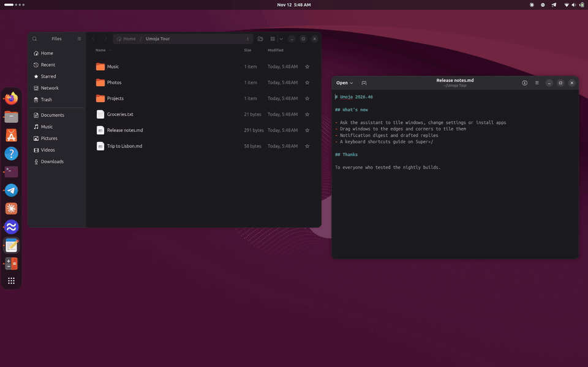
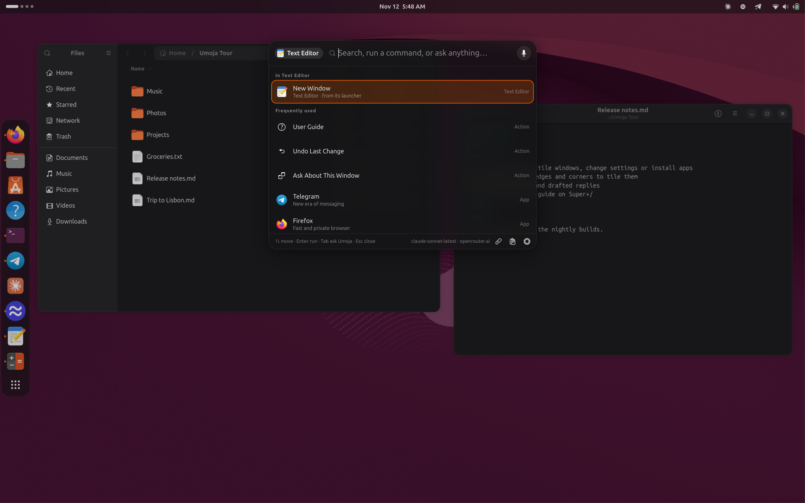
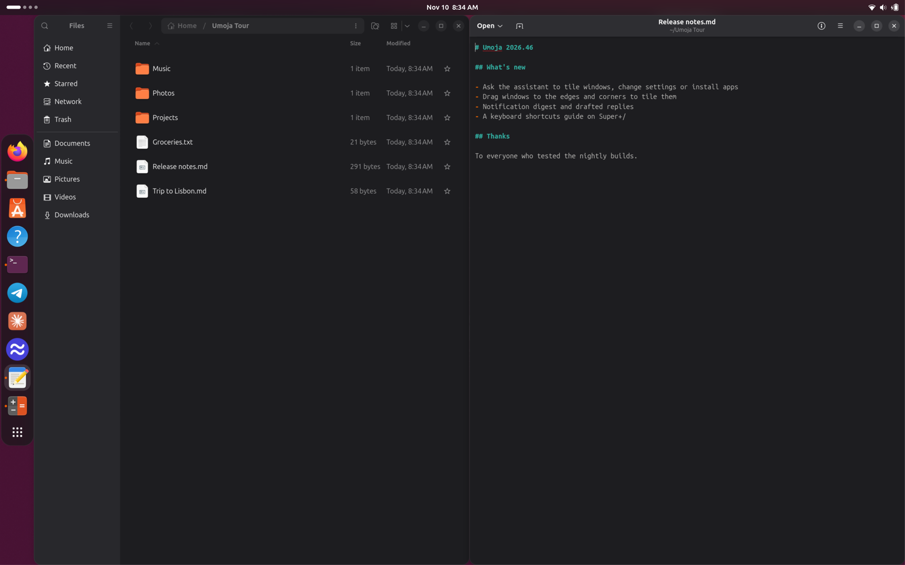
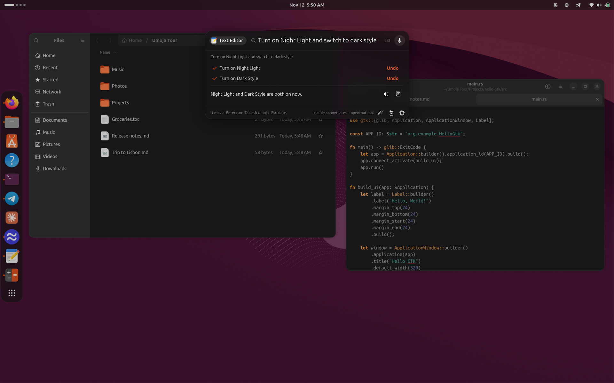
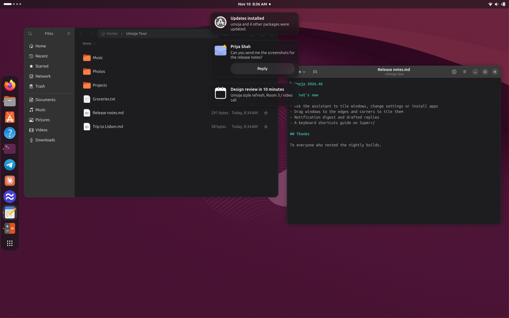
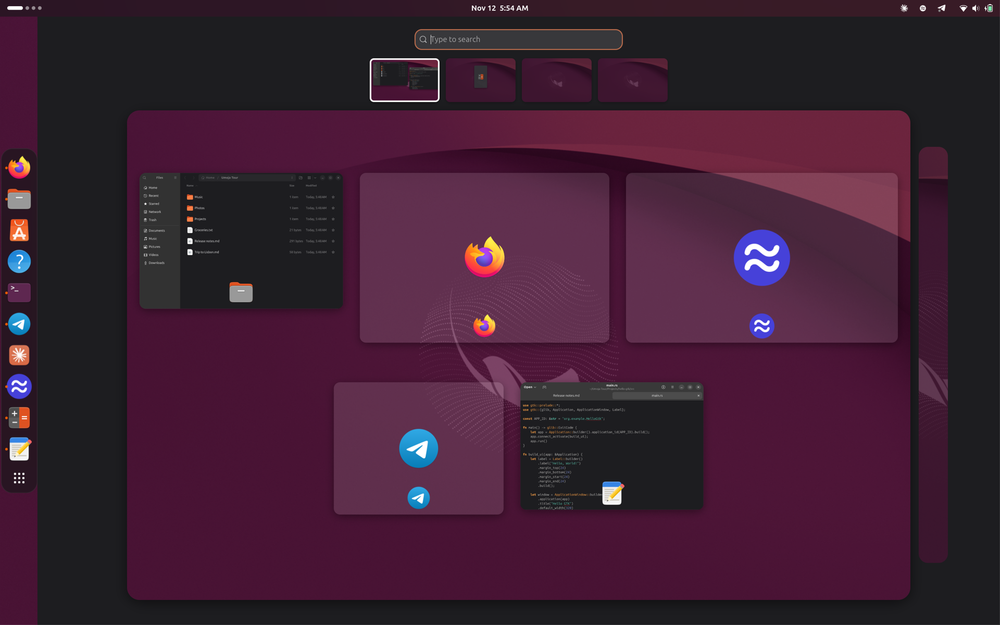
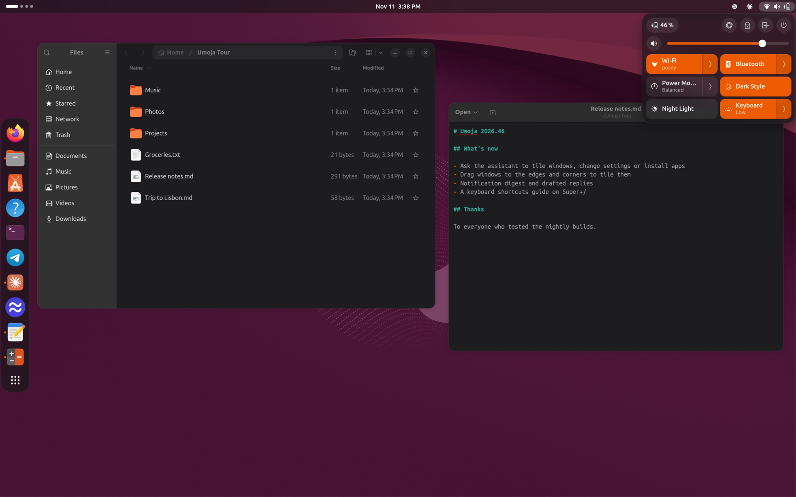

# Umoja

**An AI-first desktop for Ubuntu, built in Rust on Mir and GTK4.**

> **This is my personal playground.** Umoja is where I try out
> my vision of what an AI-first desktop could feel like. It is not an
> official Ubuntu or Canonical project, it is not supported, and it changes
> quickly: features come and go, and things break. Please treat it as an
> experiment, not as something to depend on.

[](docs/demo/videos/trailer.mp4)

*Type "btop" into Ask Umoja: it isn't installed, so Umoja offers to install
it (snap first), then runs it in a terminal.* [Watch the trailer](docs/demo/videos/trailer.mp4)
or take the [full tour](docs/demo/README.md).

## The idea

Most desktops treat AI as an app you open. Umoja treats it as part of the
desktop itself. One key brings up **Ask Umoja** over whatever you're doing,
and from there you can launch, switch, change settings, install software,
find files, or just ask, with the assistant able to act on the desktop for
you and always asking before it does anything that matters.

Everything else is deliberately familiar. Umoja behaves like Ubuntu's GNOME
session: the same settings (it reads GNOME's GSettings, so Settings works
unchanged), keyboard shortcuts, dock, Quick Settings, workspaces, overview,
screenshot UI, multi-monitor and HiDPI handling, and it runs your GNOME,
GTK, Qt, Electron, X11 and snap apps as they are. The goal is that you
could sit down at it as an Ubuntu user and only notice the new parts.

And the AI runs **on your computer by default**. Umoja ships its own copy
of [Lemonade](https://lemonade-server.ai) and picks a model that fits your
machine; a cloud model (any OpenAI-compatible endpoint, such as OpenRouter)
is an opt-in alternative.

## What's in it

### Ask Umoja

Press the **Copilot** key (or tap **Alt** on a keyboard without one) and a
card floats over the window you're in.

- **Instant results as you type**, with no model involved: apps, launcher
  actions, switches (Wi-Fi, Bluetooth, Dark Style, Do Not Disturb...),
  Settings pages, desktop actions (lock, mute, a screenshot...), sums and
  files, plus a web search row. Type a command-line
  program that isn't installed and it offers to install it, then runs it in
  a terminal.
- **The assistant** is always one row (or **Tab**) away. It answers in the
  card and can open and arrange apps and windows, change settings, install
  software (snap first) and run updates, find or remove apps however they
  were installed, read what's on screen when you ask (**Super+Shift+A**),
  work with your clipboard history (**Super+Shift+V**), troubleshoot the
  computer, explain a crash, and hand coding jobs to a coding agent such as
  Claude Code. It asks you before anything that changes your system, and it
  can ask you follow-up questions.
- **Screen reader support**: the card works with Orca, which reads out the
  selected row, confirmations and finished answers.
- **Models**: local by default on the embedded Lemonade, with a picker that
  marks the model best suited to your memory; or a cloud model through any
  OpenAI-compatible API (OpenRouter included), with the key kept in your
  keyring.

### AI around the desktop

- **Notifications** with a digest of what you missed and suggested quick
  replies, generated locally.
- **File search** by what files are about, not just their names
  (`umoja-files`, a local embedding index).
- **Copy text from the screen** (OCR) in the screenshot UI.
- **Crash help**: when an app crashes, a notification offers to explain why,
  using the local model.
- **MCP**: every desktop tool the assistant uses is served by `umoja-mcp`,
  an [MCP](https://modelcontextprotocol.io) server that other AI apps
  (Claude Code, for example) can use too. At login Umoja sets it up, with
  a skill describing the desktop, for the coding agents it finds.
- **Voice dictation** through Myna, if it is installed.

See [Using the AI features](docs/ai-features.md) for how each one works,
what the assistant asks before acting, and what stays on your computer.

### The desktop

- **umoja-mir**, a Wayland compositor built on Mir, with all of its policy
  in Rust: GNOME's keybindings, half and quarter tiling with a layout
  picker, dynamic workspaces, Super+drag to move and resize, multi-monitor
  and Settings › Displays (it implements `org.gnome.Mutter.DisplayConfig`),
  fractional scaling, Xwayland for X11 apps and games, background blur,
  screen blanking and locking with idle inhibitors, and hybrid Intel/AMD +
  NVIDIA laptops. It remembers each window's size, position, workspace and
  monitor across sessions, like mutter.
- **Top bar** with the clock and calendar, tray icons (AppIndicator), Quick
  Settings (network, VPN, Bluetooth, sound devices, power mode, keyboard
  backlight, and more), notifications in the style of Ubuntu's old notify-osd
  bubbles, the lock screen, on-screen displays for media keys, and the
  password dialog for administrator prompts.
- **Dock** that follows Ubuntu Dock's settings and pinned apps.
- **Activities overview**, app grid, workspaces, the GNOME-style
  screenshot and screencast UI, a keyboard shortcuts guide (**Super+/**),
  and a screensaver.
- **Resilient by design**: every part of the shell is its own process, so
  one crash never takes the session down, and if the compositor itself
  crashes it restarts in place instead of logging you out.
- **A login screen** (`umoja-greeter`) for LightDM that runs on the same
  compositor, over Ubuntu's default wallpaper.

## Screenshots

| Ask Umoja | Assistant: tile windows | Assistant: change settings |
| --- | --- | --- |
|  |  |  |
| **Notifications** | **Activities overview** | **Quick Settings** |
|  |  |  |

More screenshots and clips are in the [tour](docs/demo/README.md).

## Installing on Ubuntu 26.10

Umoja targets **Ubuntu 26.10** (amd64 and arm64) with the standard Ubuntu
desktop installed. Releases are published to
[ppa:ken-vandine/umoja](https://launchpad.net/~ken-vandine/+archive/ubuntu/umoja),
which also carries the patched Mir that Umoja needs.

```sh
sudo add-apt-repository ppa:ken-vandine/umoja
sudo apt install umoja-desktop
```

This also installs the Umoja login screen (`umoja-greeter`, a recommended
package), which **replaces GDM with LightDM** from the next boot. If you'd
rather keep GDM, install with `sudo apt install --no-install-recommends
umoja-desktop` and add any recommended packages you want by hand.

Then reboot (the login screen switch needs one; without `umoja-greeter`,
logging out is enough), choose **Umoja** as the session on the login
screen, and log in. The first time, Umoja downloads a local AI model in the
background (only on an unmetered connection); a notification shows its
progress, and Ask Umoja is ready once it finishes. Press **Super+/** for
every keyboard shortcut.

The default local model is Qwen3-4B-Instruct-2507; the model picker marks
the largest one that fits in a quarter of your memory as **Best for this
computer**. On a machine with little memory, a cloud model is the better
choice.

### Daily builds

Every change to `main` is built into
[ppa:ken-vandine/umoja-edge](https://launchpad.net/~ken-vandine/+archive/ubuntu/umoja-edge).
It is even less tested than the releases. It builds on the release PPA, so
add both:

```sh
sudo add-apt-repository ppa:ken-vandine/umoja
sudo add-apt-repository ppa:ken-vandine/umoja-edge
sudo apt install umoja-desktop
```

### Removing it

```sh
sudo apt remove umoja-greeter umoja-desktop
sudo add-apt-repository --remove ppa:ken-vandine/umoja
```

Removing `umoja-greeter` switches the login screen back to GDM. The patched
Mir packages from the PPA stay installed; `sudo ppa-purge
ppa:ken-vandine/umoja` instead of the last line also downgrades them to
Ubuntu's versions.

## Feedback

Bug reports and ideas are welcome in
[GitHub issues](https://github.com/kenvandine/umoja/issues), with the
caveat above: this is a playground, so I may not get to them, and the
direction follows whatever I want to try next.

## For developers

### Layout

| Path | What it is |
| --- | --- |
| `crates/umoja-mir` | Wayland compositor. A thin MirAL C++ shim (`src/shim/`) with all policy in Rust: GNOME keybindings, half/quarter tiling with group resize, dynamic workspaces, multi-monitor, `org.gnome.Mutter.DisplayConfig` for Settings › Displays, HiDPI defaults, screen blanking (after the screensaver) and lock-on-blank from Settings › Power / Privacy with idle inhibitors (`org.freedesktop.ScreenSaver`, `org.gnome.SessionManager` Inhibit, Wayland idle-inhibit). |
| `crates/umoja-panel` | Top bar: Activities, clock/calendar, AppIndicator tray (`org.kde.StatusNotifierWatcher` with native dbusmenu menus), network (NetworkManager), volume and battery (UPower) indicators, Quick Settings with Wi-Fi/Wired tiles and a network list, the lock screen, notifications, and the PolicyKit authentication agent (the "Authentication Required" password dialog). |
| `crates/umoja-screensaver` | The screensaver: "umoja" drawn in Ubuntu-orange circles that fly in and out with a different effect each cycle (gather, orbit, rain, spiral, rings, bloom), inspired by Omarchy's. It starts at Settings › Power › Screen Blank and the screen blanks `org.umoja.shell screensaver-duration` (300 s) later. `umoja-screensaver` previews it; `umoja-screensaver --activate` runs the real idle path. |
| `crates/umoja-dock` | Ubuntu Dock work-alike driven by the `dash-to-dock` GSettings keys and `favorite-apps`, with running dots from `zwlr_foreign_toplevel`. |
| `crates/umoja-overlay` | App grid + search, Ask Umoja (type-ahead card with the Lemonade assistant), Myna dictation, the GNOME-style screenshot UI (selection, screen or window; screenshot or screencast via `wf-recorder`), and the keyboard shortcuts guide (Super+/, read live from `org.umoja.Compositor.GetShortcuts`). |
| `crates/umoja-greeter` | LightDM greeter over Ubuntu's default wallpaper (`warty-final-ubuntu.png`). |
| `crates/umoja-portal` | `xdg-desktop-portal-umoja`: Settings (GNOME keys incl. `button-layout`), Screenshot, ScreenCast (stub). |
| `crates/umoja-mcp` | `umoja-mcp`, the MCP server that holds every desktop tool the assistant uses (apps, windows, settings, notifications, diagnostics); other AI apps can use it too. |
| `crates/umoja-files` | The file search service: indexes your files with a local embedding model so you can find them by what they are about. |
| `crates/umoja-common` | GSettings, i18n (reuses gnome-shell/GTK/control-center translations), HiDPI rules, shared types. |
| `data/` | Session file, GSettings schema, systemd user units, portal + LightDM config. |
| `debian/` | Packaging for `umoja-desktop` and `umoja-greeter`. |
| `tools/demo` | `umoja-demo`: drives a hands-free tour of a live session and captures screenshots, clips and a Markdown page ([how](tools/demo/README.md)). |

### Building

```sh
sudo apt build-dep ./          # or install the Build-Depends in debian/control
make                           # cargo build --release --workspace
make test                      # headless unit tests
make greeter-preview           # greeter UI with sample users, no LightDM needed
make greeter-nested            # the same in umoja-mir's greeter mode, in a window
make nested                    # run the compositor in a window of your session
```

Packages: `make deb` (binary) or `make source-package` (what the PPA gets).
Both run `make vendor` first, which vendors crates and downloads the pinned
Lemonade build (checksums in `lemonade.sha256`), because Launchpad builds
offline.

### Embedded Lemonade

`umoja-desktop` ships its own copy of Lemonade's embeddable server in
`/usr/lib/umoja/lemonade` and runs it per user as `umoja-lemonade.service`
on **127.0.0.1:13345**, with config in `~/.config/umoja/lemonade` and models
in `~/.cache/umoja/lemonade`. It never uses Lemonade's default port 13305,
so the `lemonade-server` package can be installed alongside it. To change
the port, put `UMOJA_LEMONADE_PORT=<port>` in `~/.config/umoja/lemonade.env`.

The GPU in most laptops shares memory with the desktop, so Umoja seeds
Lemonade with limits from `/usr/share/umoja/lemonade/defaults.json`: a 16k
token context (Lemonade's auto-tune would otherwise size it to fill VRAM and
GTT), one request at a time, and one loaded model per type. llama.cpp's
Vulkan buffers go in GTT rather than the VRAM carve-out the compositor needs
(`UMOJA_LEMONADE_PREFER_HOST_MEMORY=0` in `lemonade.env` turns that off).
Anything in `~/.config/umoja/lemonade/config.json` overrides these defaults.

If the compositor crashes during a session, `umoja-session` restarts it in
place (up to 3 times in 10 minutes) instead of logging you out. Open apps
are lost, but the panel, dock, overlay and Lemonade come back, along with
your autostart apps.

Apps set to start at login (`~/.config/autostart`, `/etc/xdg/autostart`,
and snaps through `snap userd --autostart`) start the way they do in GNOME:
`umoja-session.target` pulls in systemd's `xdg-desktop-autostart.target`,
so each one runs as its own `app-*@autostart.service` and follows the same
`OnlyShowIn`/`NotShowIn`, `Hidden`, `TryExec` and
`X-GNOME-Autostart-enabled` rules. `journalctl --user -u 'app-*@autostart.service'`
shows what started.

### Login screen

Installing `umoja-greeter` on a standard Ubuntu desktop switches the
display manager from GDM to LightDM (on first install only; it applies at
the next boot) and selects the Umoja greeter and session. Removing the
package switches back to GDM.

The greeter runs on Wayland: LightDM starts
`/usr/libexec/umoja-greeter-session`, which runs `umoja-mir` in greeter
mode (no session services, keybindings or Xwayland) with `umoja-greeter`
as its only client, so the login screen and the desktop share one
compositor. If `umoja-mir` can't start, the script falls back to the same
greeter on an X server it starts itself, so the machine still gets a login
screen. To use the X11 greeter permanently, put
`greeter-session=lightdm-umoja-greeter-x11` under `[Seat:*]` in a file in
`/etc/lightdm/lightdm.conf.d/`.

On hybrid laptops (an integrated GPU plus NVIDIA), `umoja-mir` keeps the
NVIDIA GPU out of the compositor (`--driver-quirks skip:driver:nvidia`, or
`nouveau`) unless a screen is connected to it when the session starts, so
the dGPU can sleep. Screens on NVIDIA-wired ports (in Hybrid mode, often
the HDMI and rear USB-C ports) are driven by Mir's atomic-kms backend with
the NVIDIA driver's own GBM, as on GNOME; a monitor plugged into one later
needs a new login. Set `UMOJA_ALL_GPUS=1`, or your own
`MIR_SERVER_DRIVER_QUIRKS`, to always use every GPU. Don't install
`mir-platform-graphics-eglstream-kms` alongside: it hangs on display
configuration changes.

### Versions

Releases are numbered `vYYYY.WW.REVISION`: the ISO year and week, then a
counter that starts at 1 each week (`v2026.46.6`). Daily builds in the edge
PPA are the latest release plus the commits since it, so they always sort
above the release they build on.

### Testing on a real machine

```sh
sudo lightdm --test-mode --debug       # greeter in a window
```

Then log into the Umoja session, press Super for the overview, the Copilot
key (or tap Alt) for Ask Umoja, Print for the screenshot UI
(Ctrl+Shift+Alt+R to record the screen), and try Settings › Displays to
change scale. `tools/demo/umoja-demo` runs a hands-free tour of a live
session and captures screenshots and clips ([how](tools/demo/README.md)).

## License

Umoja is free software under the GNU General Public License, version 3 or
later. It ships a copy of [Lemonade](https://github.com/lemonade-sdk/lemonade)
(Apache-2.0) and GNOME Shell's symbolic icons (GPL-2.0-or-later); see
[LICENSE](LICENSE) and [debian/copyright](debian/copyright) for details.
