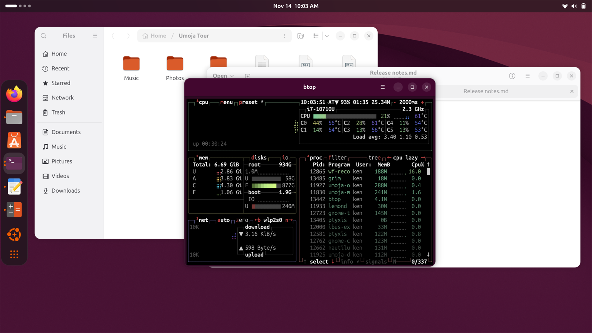
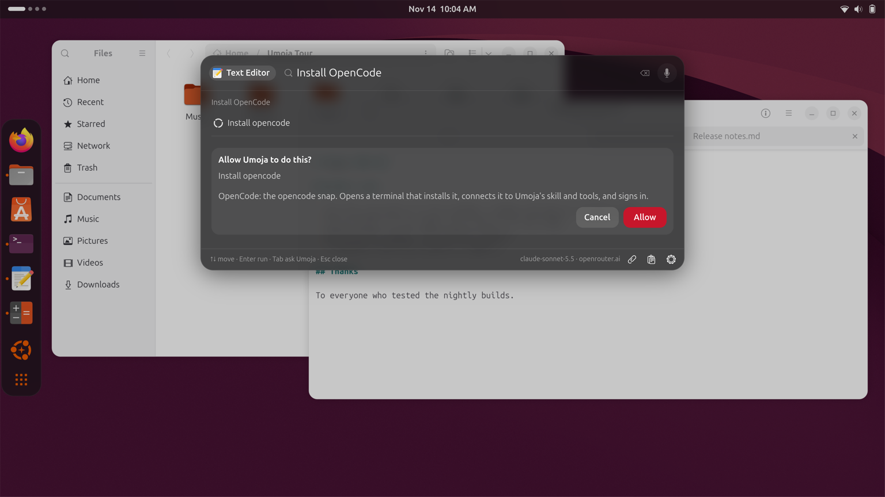
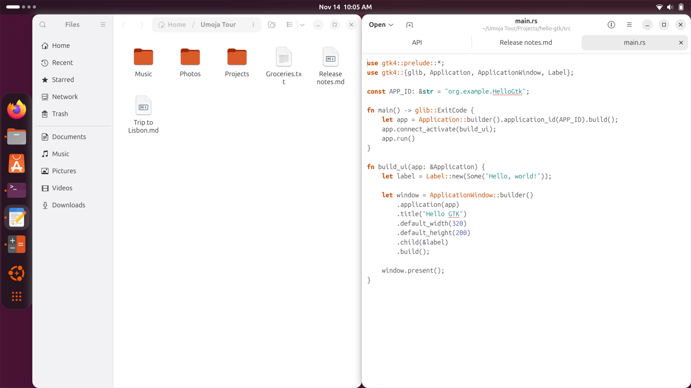
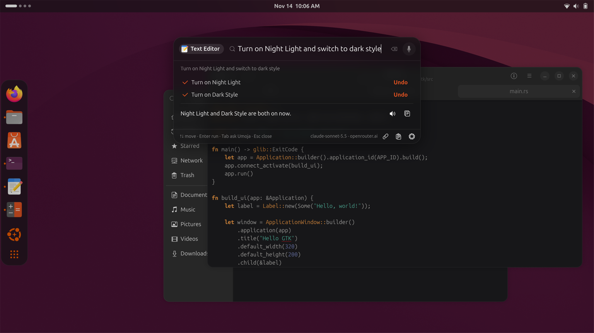

## Screenshots

| Ask Umoja: install and run btop | Coding agent: OpenCode | Assistant: tile windows | Assistant: change settings |
| --- | --- | --- | --- |
|  |  |  |  |

More in the [tour](/docs/demo/README.md).
