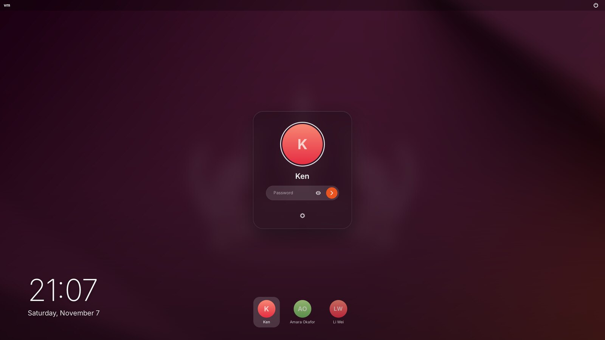
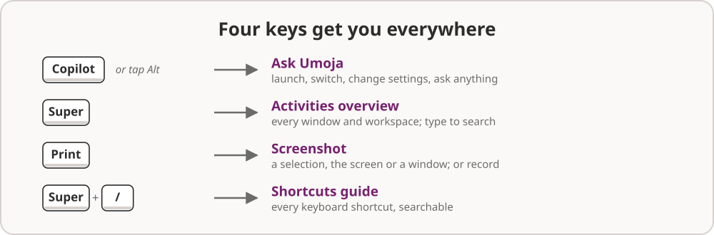
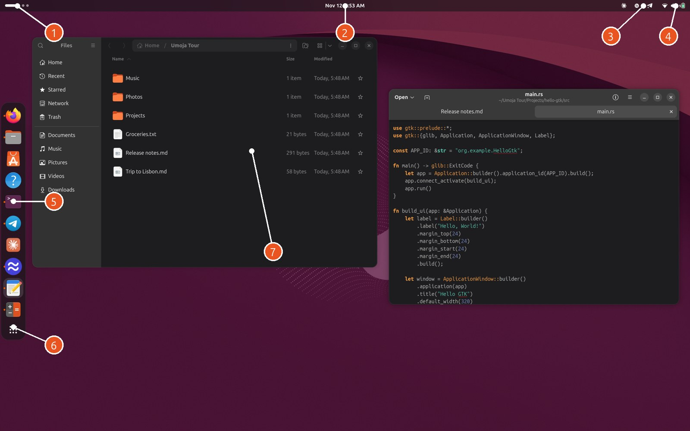
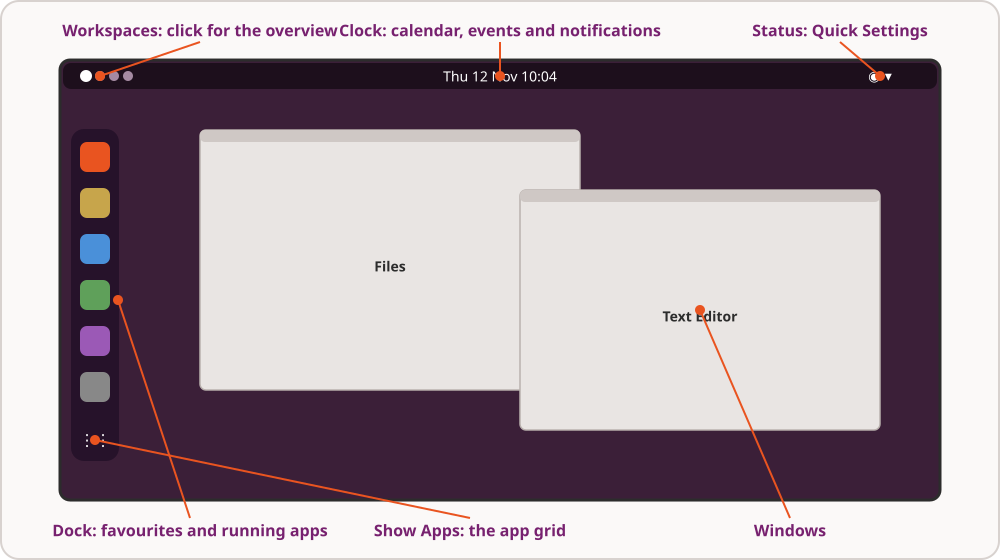

# 1. Getting started

## Logging in

When the computer starts, the login screen shows the last person who logged
in. Type your password and press **Enter**. To log in as someone else, click
their picture along the bottom of the screen.

The login screen remembers which desktop you used last. If more than one is
installed (Umoja and Ubuntu's GNOME, say), choose **Umoja** with the session
button under the password box before you log in. The button in the top-right
corner restarts or powers off the computer.

## The first time you log in

Umoja gets a few things ready in the background the first time. None of
them needs you:

- **The AI model downloads.** The assistant runs on your own computer, so it
  needs a model. Umoja picks one that suits your computer's memory and
  downloads it, but only on a connection that isn't metered (so not over
  your phone's hotspot). A **Downloading AI model** notification shows the
  progress. Everything else on the desktop works while you wait.
- **Your files are indexed**, so you can later find them by what they're
  about and not only by their name. This runs at idle priority, and it only
  reads file contents while the computer is plugged in.
- **Coding agents are connected.** If you use Claude Code, Codex, GitHub
  Copilot, Antigravity, OpenCode or Gemini CLI, they're set up to use
  Umoja's desktop tools too. A notification tells you which ones.

## Four keys to remember

You can do almost everything with the mouse, but these four keys are worth
learning on day one:

| Key | What it does |
| --- | --- |
| **Copilot**, or a quick tap of **Alt** | Opens **Ask Umoja**, the card where you can launch, switch, search and ask for anything |
| **Super** | Opens the **Activities overview**: every open window, your workspaces, and a search box |
| **Print** | Opens the **screenshot tool** |
| **Super+/** | Shows the **keyboard shortcuts guide**, with every shortcut in one place |

On a keyboard without a Copilot key, a quick tap of the left **Alt** key
opens Ask Umoja. Holding Alt for a shortcut such as **Alt+Tab** works as
usual. Once Umoja has seen a Copilot key, Alt goes back to your apps.

## A map of the screen

1. **Workspace indicator.** The long dot is the workspace you're on, and
   the small dots are the others. Click it to open the Activities overview.
2. **The clock.** Click it to see your notifications, the calendar and
   today's events.
3. **Tray icons** for apps that run in the background, such as chat apps or
   a VPN client. Click one for its menu.
4. **The status menu**, also called **Quick Settings**: battery, Wi-Fi,
   sound, Bluetooth, Dark Style, power and more.
5. **The dock**, with your favourite apps and the apps that are running. A
   small orange dot beside an icon means the app is open.
6. **Show Apps** opens the app grid with all your apps.
7. **Windows.** Your apps, which you can move, resize, tile and spread over
   workspaces and monitors.

The next chapter, [The basics](02-the-basics.md), takes each of these in
turn.
