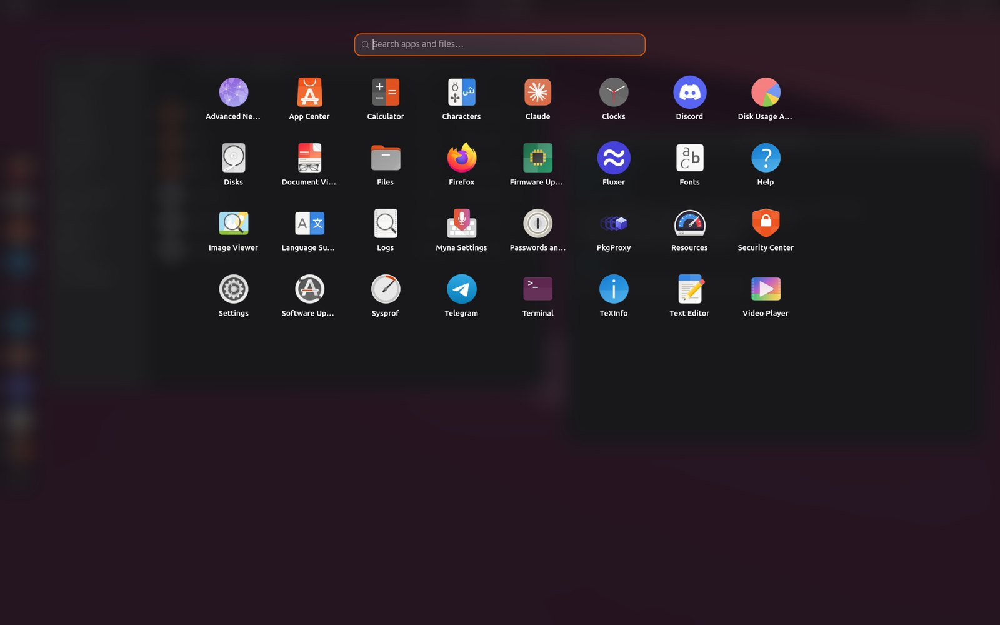
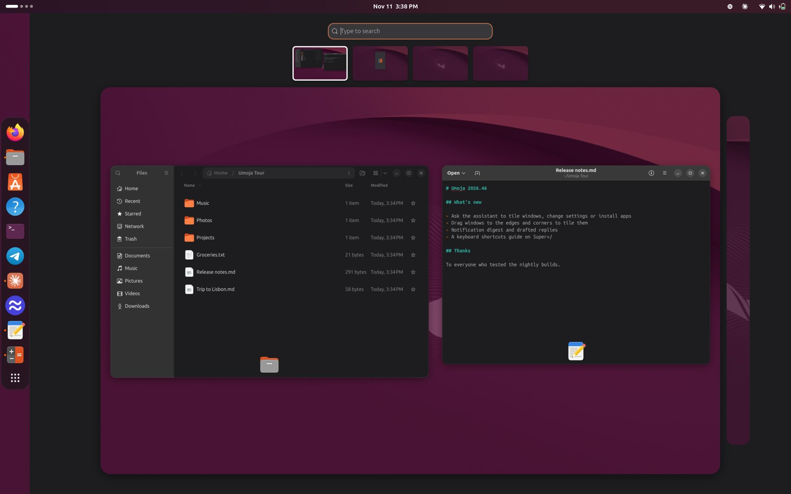
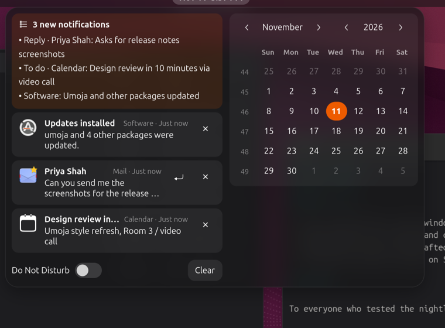
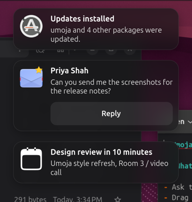
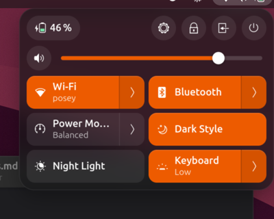
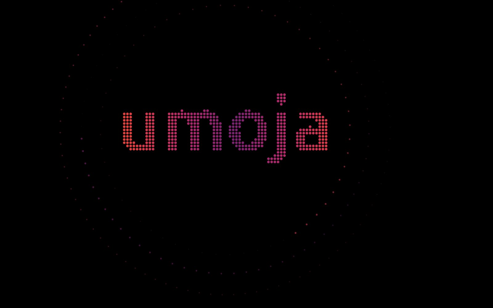

# 2. The basics

This chapter covers everyday things: opening apps, handling windows, and
the menus in the top bar. If you've used Ubuntu, skim it. It all works the
way you expect.

## Opening apps

There are four ways to open an app. Use whichever you like.

- **From the dock.** Click an icon on the dock on the left. Click again
  on a running app to bring its window forward. If it has several windows,
  you can pick one.
- **From the app grid.** Click **Show Apps** (the grid of dots at the
  bottom of the dock), or press **Super+A**. Every app is there. Start
  typing to search: apps come first and matching files are listed under
  them.
- **From the overview.** Press **Super** and type the app's name.
- **From Ask Umoja.** Press **Copilot** (or tap **Alt**), type a few
  letters of the app's name and press **Enter**. This is usually the
  quickest, and it also finds an app's own actions, such as "firefox
  private" for a new private window.

### The dock

Right-click an app on the dock (or in the app grid) for its menu:

- the app's own actions, such as **New Window** or **New Private Window**
- **Pin to Dock** or **Unpin**, to keep it on the dock or take it off
- **App Details**, which opens the app in App Center
- **Quit**, which closes all of its windows

To rearrange the dock, drag an icon to a new place. The dock uses Ubuntu
Dock's settings, so **Settings › Ubuntu Desktop** changes its size, its
position (left, bottom or right) and whether it hides when a window
touches it. You can also just ask: "put the dock at the bottom".

## Handling windows

Windows behave the way they do in Ubuntu:

- **Move** a window by dragging its title bar. You can also hold **Super**
  and drag anywhere in the window.
- **Resize** by dragging an edge or a corner. You can also hold **Super**
  and drag with the middle mouse button.
- **Maximize** by double-clicking the title bar, or pressing **Super+Up**.
  **Super+Down** restores it.
- **Minimize (hide)** with **Super+H**.
- **Close** with the × button or **Alt+F4**.
- **The window menu** has Take Screenshot, Always on Top, Always on Visible
  Workspace and moving to another workspace or monitor. Open it by
  right-clicking the title bar, pressing **Alt+Space**, or holding **Super**
  and right-clicking anywhere in the window.

To put two windows side by side, drag one to the left edge of the screen
and the other to the right edge. There is much more about this in
[Windows, workspaces and displays](03-windows-and-workspaces.md).

### Switching between windows

- **Alt+Tab** switches between windows, and **Super+Tab** between apps.
  Keep holding **Alt** (or **Super**) and press **Tab** again to go
  further along. Add **Shift** to go back.
- **Alt+`** (the key above Tab) switches between windows of the same app.
- **Super** opens the overview, where you can see every window at once
  and click the one you want.

## Copy and paste

**Ctrl+C** and **Ctrl+V** work everywhere, as usual. Umoja also has two
extras:

- **Middle-click paste.** Select text and click the middle mouse button
  (or press the scroll wheel) where you want it. It's pasted without
  touching your clipboard, as on most Linux desktops.
- **Clipboard history.** **Super+Shift+V** shows everything you've copied
  this session, so you can paste something you copied earlier. See
  [Clipboard history](07-everyday-ai.md#the-clipboard-history).

## The top bar

### The clock, the calendar and notifications

Click the clock, or press **Super+V**, to open the date menu.

- **On the right** is a calendar for the month, with today in orange. Days
  with events have a small mark. Click a day to see its events.
- **Under the calendar** are that day's events from the calendars you've
  added in **Settings › Online Accounts** (Google, Microsoft and others)
  or in GNOME Calendar. If you haven't added any, this part stays hidden.
- **On the left** are your notifications, newest first. Click one to open
  the app it came from, or click × to dismiss it. When two or more arrived
  since you last looked, a **summary** at the top tells you what you
  missed. See [Notification digests](07-everyday-ai.md#notifications-what-you-missed-and-quick-replies).
- **Do Not Disturb**, at the bottom, stops notification pop-ups. They
  still arrive here for later. **Clear** removes them all.

### Notifications

Notifications pop up as dark bubbles at the top of the screen and fade
away by themselves. Chat and mail messages get a **Reply** button with
suggested replies (see [Quick replies](07-everyday-ai.md#notifications-what-you-missed-and-quick-replies)).

While you're recording your screen, or using an app full screen, the bubbles wait so they don't interrupt you. When you're done,
one notification sums up what came in. See
[Automatic Do Not Disturb](07-everyday-ai.md#automatic-do-not-disturb).

### Quick Settings

Click the status icons at the right of the top bar.

- **Along the top**: the battery level, then buttons for **Settings**,
  **Lock**, **Log Out** and **Power Off**.
- **Sliders** for volume, for the screen brightness on laptops, and for
  your microphone while an app is using it. The arrow beside the volume
  slider picks the speakers or headphones.
- **Tiles.** Click a tile to turn it on or off. Click its arrow (›) for
  more, such as the list of Wi-Fi networks or your Bluetooth devices.
  - **Wi-Fi**, **Wired** (only while a cable is plugged in) and **VPN**
    (only if you have VPN connections set up)
  - **Bluetooth**
  - **Power Mode**: Performance, Balanced or Power Saver
  - **Dark Style** and **Night Light**
  - **Keyboard** backlight, on laptops that have one

### Tray icons

Apps that keep running in the background, such as chat apps, sync clients
or a VPN, put a small icon in the top bar. Click it for the app's menu. A
dot or number on the icon means the app wants your attention.

## Locking, logging out and shutting down

- **Lock the screen** with **Super+L**, or the **Lock** button in Quick
  Settings. To unlock, click or press any key, then type your password.
- **Log out** or **power off** with the buttons in Quick Settings. A card
  asks you to confirm. It goes ahead by itself after 60 seconds, so you can
  walk away. From the Power Off card you can also choose **Restart**.
- **When you leave the computer alone**, a screensaver comes on at the time
  set in **Settings › Power › Screen Blank**. A little later the screen
  turns off, and it locks if **Settings › Privacy › Screen Lock** says so.
  Apps playing video, and calls, keep the screen on.

Volume, brightness and media keys work as you'd expect, and show a small
display at the bottom of the screen with the new level.

## Settings

Umoja uses Ubuntu's **Settings** app, and changes there take effect
straight away: the wallpaper, Displays, Sound, Keyboard shortcuts, Power,
Accessibility and the rest. Open it from Quick Settings, from the app
grid, or by typing what you want into Ask Umoja ("sound", "displays",
"keyboard").

Or skip Settings and ask: "make the text bigger", "show the battery
percentage", "stop the screen dimming so fast". See
[The assistant](06-the-assistant.md).
