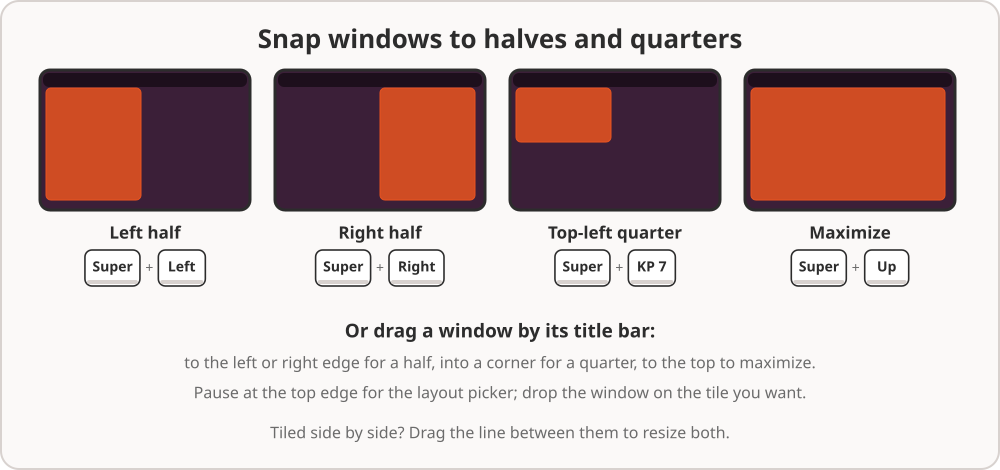
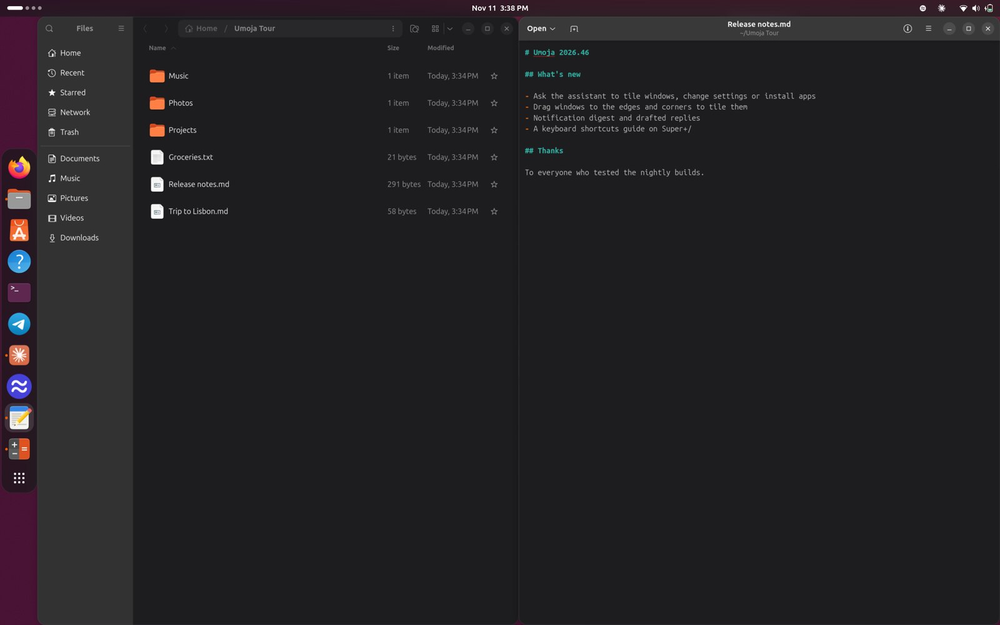
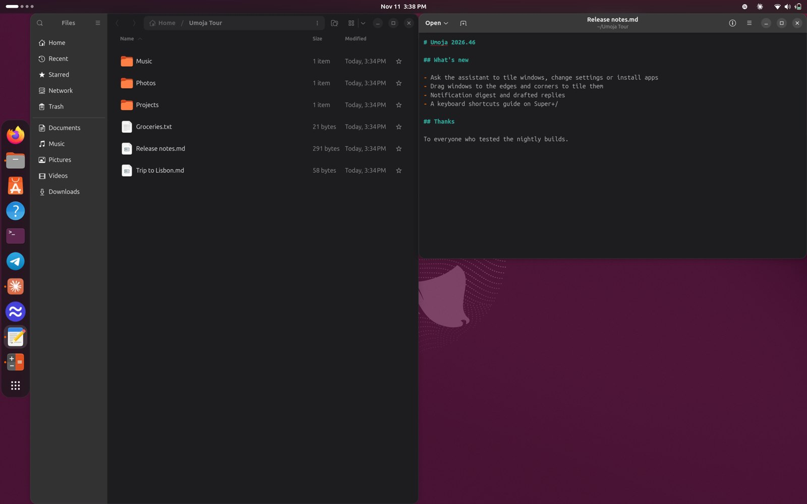
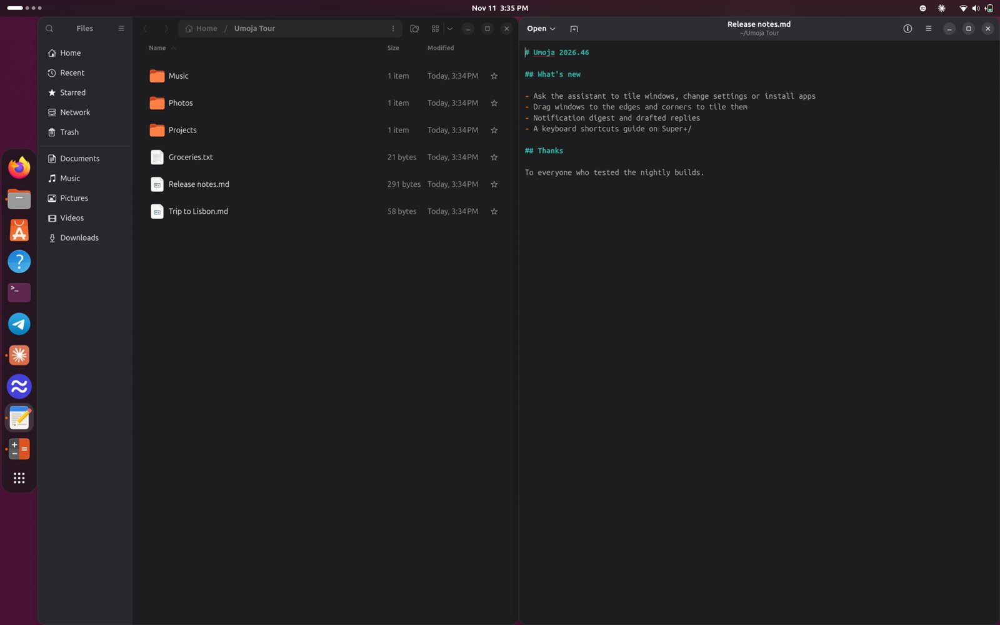
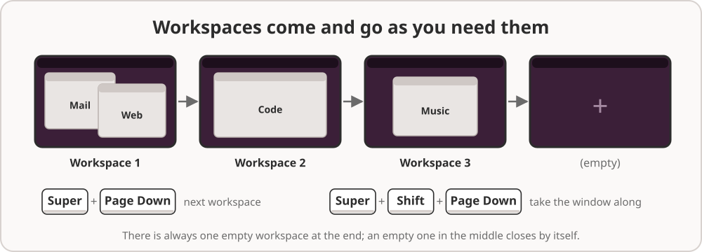
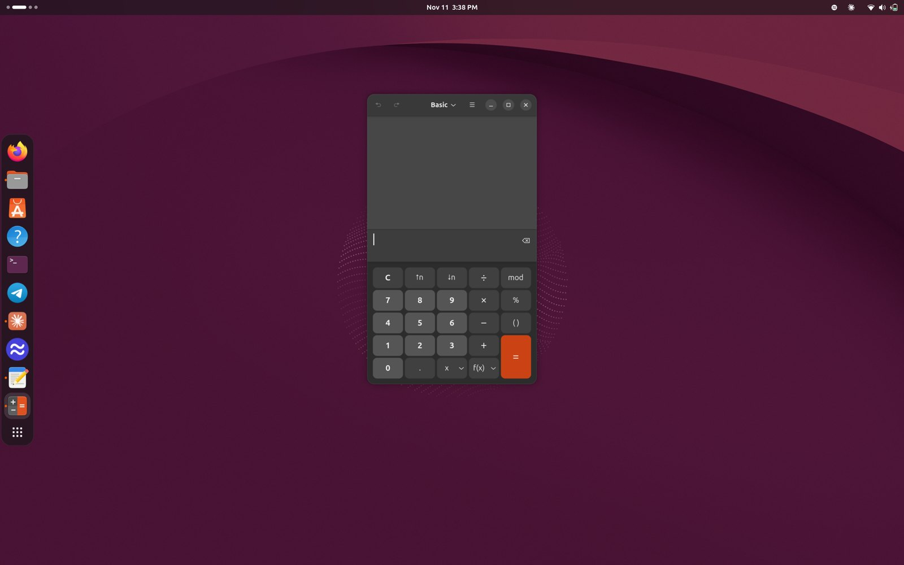

# 3. Windows, workspaces and displays

## Tiling: windows side by side

Most of the time you want two or four windows next to each other, not
piled on top of one another. Umoja snaps windows into place for you.

**With the mouse**, drag a window by its title bar:

- to the **left or right edge** of the screen for half the screen
- into a **corner** for a quarter
- to the **top edge** to maximize it

A shaded area shows where the window will go before you let go.

**With the keyboard**:

| Keys | Where the window goes |
| --- | --- |
| **Super+Left** / **Super+Right** | Left or right half |
| **Super+Up** / **Super+Down** | Maximize, or restore |
| **Super+keypad 8** / **Super+keypad 2** | Top or bottom half |
| **Super+keypad 7**, **9**, **1**, **3** | The four quarters |

When two windows are tiled side by side, **drag the line between them** to
make one wider and the other narrower at the same time.

### The layout picker

Drag a window to the top of the screen and pause there. A small card of
layouts opens, each one split into tiles. Drop the window on the
tile you want it in.

### Or just ask

Ask Umoja can arrange windows for you: "put the terminal on the left and
Firefox on the right", "maximize Files", "move this to the other monitor".

To bring back a whole arrangement of windows by name, use a
[setup](08-setups-and-automations.md#setups).

## Workspaces

Workspaces are like extra screens. Keep mail and chat on one, your work on
another and music on a third, and switch between them instead of hunting
through a pile of windows.

Umoja manages workspaces for you, as Ubuntu does: there is always one empty
workspace at the end, ready to use. An empty workspace in the middle goes
away by itself.

| Keys | What it does |
| --- | --- |
| **Super+Page Down** / **Super+Page Up** | Next or previous workspace (also **Ctrl+Alt+Right**/**Left**) |
| **Super+Shift+Page Down** / **Up** | Take the current window to the next or previous workspace |
| **Super+Home** / **Super+End** | First or last workspace |

The dots at the left of the top bar show which workspace you're on. In the
**overview** (**Super**), your workspaces are along the top: click one to
go there, or drag a window onto one to move it.

You can also ask: "go to workspace 2", "move Files to workspace 3".

## Several monitors

Plug in a monitor and Umoja uses it straight away, with the dock on every
monitor.

- **Arrange your monitors** in **Settings › Displays**: drag them to match
  how they sit on your desk, choose the main one, and set each one's
  resolution, refresh rate, scale and rotation. A new monitor is placed to
  the right of the others until you change it.
- **Move a window to another monitor** with **Super+Shift+Left** or
  **Super+Shift+Right** (or up and down), by dragging it across, or from
  the window menu.
- Umoja **remembers** each window's size, position, workspace and monitor,
  so apps open where you left them, even after you log out.

## Display scale and HiDPI

On a high-resolution screen everything can look tiny. Umoja picks a
sensible scale when you first log in, and you can change it in **Settings ›
Displays › Scale**, including fractional scales such as 125% or 150%. To
make only the text bigger, use **Settings › Accessibility › Large Text**,
or ask "make the text bigger".

## Apps from anywhere, and games

Umoja runs every kind of app: GNOME and GTK apps, Qt and KDE apps,
Electron apps like VS Code, Discord and Slack, snaps, Flatpaks and
AppImages. It also runs older X11 apps and games through Xwayland, which
starts by itself when an app needs it.

Games that run full screen get the screen to themselves. Notifications wait
until you leave full screen, so they don't pop up mid-game (see
[Automatic Do Not Disturb](07-everyday-ai.md#automatic-do-not-disturb)).

## Laptops with two graphics cards

Many laptops have an Intel or AMD graphics chip plus an NVIDIA card. Umoja
uses the built-in chip for the desktop and lets the NVIDIA card sleep to
save battery. A monitor plugged into a port that's wired to the NVIDIA card
works too, but needs a new login after you plug it in. If your laptop's
firmware has a graphics setting, choose **Hybrid**.
