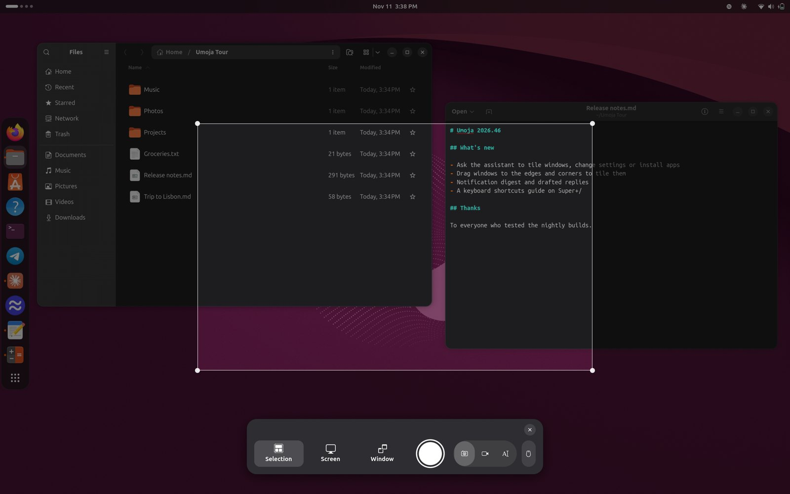
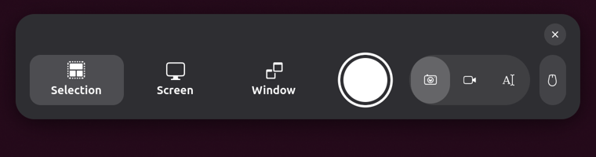

# 4. Screenshots and screen recording

## Taking a screenshot

Press **Print**. A toolbar appears at the bottom of the screen.

1. Choose what to capture:
   - **Selection**: drag out a rectangle. Drag its corners to adjust it.
   - **Screen**: the whole screen. With several monitors, click the one you
     want.
   - **Window**: click a window.
2. Click the big round button.

The screenshot is saved in **Pictures › Screenshots** and copied to the
clipboard, so you can paste it straight into a chat or a document. A
notification shows it. Click the notification to open the picture.

**Escape** closes the tool without taking anything.

Shortcuts skip the toolbar:

| Keys | What it captures |
| --- | --- |
| **Print** | Opens the screenshot tool |
| **Shift+Print** | The whole screen, straight away |
| **Alt+Print** | The window you're in, straight away |
| **Super+Ctrl+Print** | Copy the text in an area (see below) |
| **Ctrl+Alt+Shift+R** | Start or stop recording the screen |

You can also ask: "take a screenshot of this window", "screenshot Firefox
in 3 seconds".

## Screenshots named by what they show

A folder full of files called *Screenshot From 2026-11-12 10-04-33.png*
isn't much help a week later. So after you save a screenshot, Umoja reads
the text in it and asks the local AI model for a few words about it. Then
it adds those words to the file name:

> Screenshot From 2026-11-12 10-04-33 **– Invoice from Acme**.png

This happens on your computer, a moment after the screenshot is saved. If
the picture has no text, or the model isn't ready, the name stays as it
was. To turn it off, ask "turn off screenshot names", or run
`gsettings set org.umoja.shell screenshot-names false`.

## Copying text from the screen

Sometimes the text you need is stuck in an image, a video or a dialog you
can't select: a phone number in a photo, or an error message.

1. Press **Super+Ctrl+Print** (or press **Print** and choose the **Copy
   Text** mode on the right of the toolbar).
2. Drag over the text and click the capture button.

The text is read with OCR and put on your clipboard. A notification shows
how it starts. Nothing is saved to Pictures. OCR can misread things, so
check what you paste.

## Recording the screen

1. Press **Ctrl+Alt+Shift+R**, or press **Print** and switch to the
   **Screencast** mode (the camera icon).
2. Choose a selection, the screen or a window, and click the round button.
3. A red recording indicator appears in the top bar. Click it to stop, or
   press **Ctrl+Alt+Shift+R** again.

Recordings are saved in **Videos › Screencasts**. While you record,
notification pop-ups wait so they don't end up in your video. You get a
summary when you stop.
