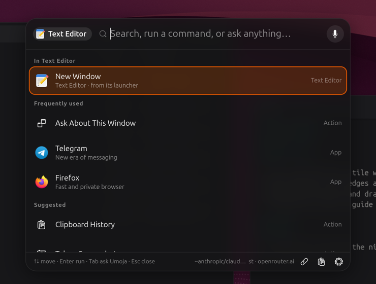
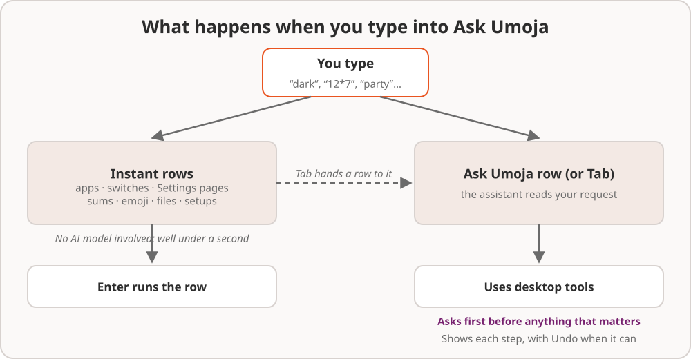
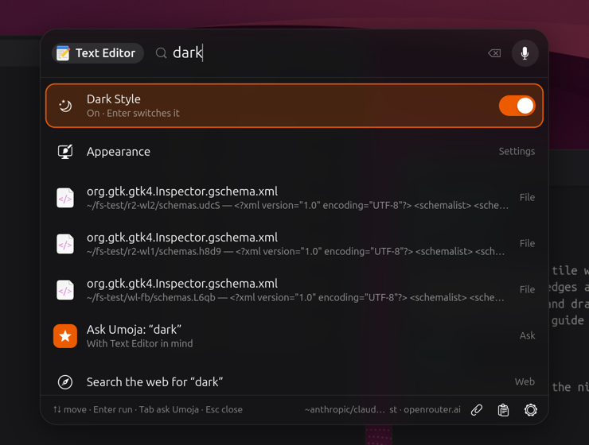
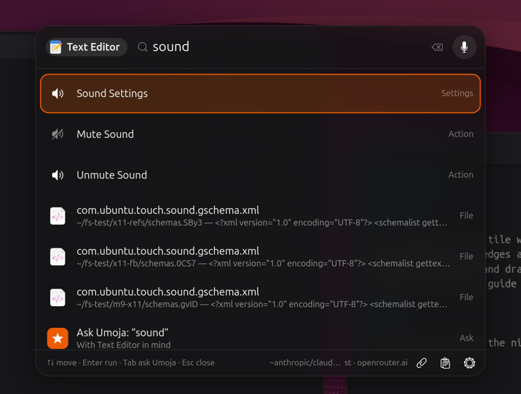
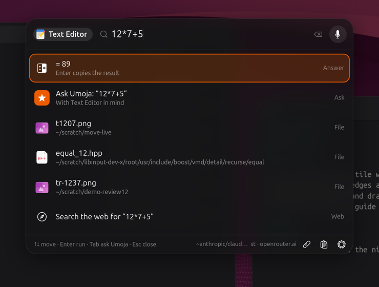
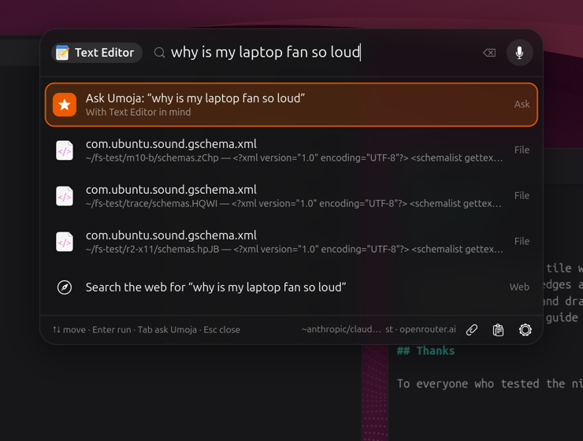

# 5. Ask Umoja

Ask Umoja is the heart of the desktop. Press **Copilot**, or tap **Alt** on
a keyboard without one. A card floats over the window you're in, ready for
you to type.

You can treat it as a launcher, a switchboard, a calculator, an emoji
picker and a search box. When you need more, it's also an assistant you
can talk to.

## Moving around the card

| Key | What it does |
| --- | --- |
| **↑** and **↓** | Move through the rows |
| **Enter** | Run the selected row |
| **Tab** | Ask the assistant about whatever is selected |
| **Escape**, or a click outside | Close the card |
| **Backspace** in an empty box | Search everything, not just the current app |

## The app you're in comes first

The card knows which window you were in, and shows that app as a chip
beside the search box (*Text Editor* above). Its own actions, such as
**New Window**, come first, and questions you ask are about it.
Press **Backspace** in the empty box, or click the chip, to search
everything instead.

With nothing typed, the card shows that app's actions, the things you use
most, and a few suggestions. It learns which rows you pick, but never
what you typed. If you turn off **Settings › Privacy › Remember App Usage**,
it remembers nothing.

## What you can type

All of these appear **instantly as you type**. No AI is involved, so
they're ready in well under a second.

### Apps and their actions

Type part of a name: "fire" for Firefox, "term" for the terminal. Add an
action to go straight there: "firefox private".

### Switches

"dark", "wifi", "bluetooth", "night light", "do not disturb". Each one
shows its current state, and **Enter** flips it. "wifi off" or "turn on
bluetooth" offers exactly that.

### Desktop actions

"mute", "pause", "next track", "power saver", "lock", "log out", "empty
trash", "screenshot", "record screen", "clipboard". The ones that matter,
like logging out or emptying the Trash, ask before they happen.

### Settings pages

"sound", "displays", "keyboard", "wallpaper", "printers". **Enter** opens
that page of Settings.

### Sums

"12*7+5", "15% of 80", "2^10". **Enter** copies the answer.

### Emoji

Type a word followed by "emoji", or start with a colon: "party emoji" or
":party" shows 🎉 🥳 🎊 and friends. A single word such as "party" also
offers a few emoji further down the list. **Enter** types the emoji into
the app you were in. If it can't be typed there, it's copied so you can
paste it.

### Your setups

If you've saved a [setup](08-setups-and-automations.md#setups), type its
name ("coding") and a **Set Up "Coding"** row brings back all its apps and
windows.

### Files

Files matching what you typed are listed, by name and by what they're
about. **Enter** opens one. "the pdf about the lease" finds it even if the
file is called *scan0042.pdf*. See
[Finding files](07-everyday-ai.md#finding-files).

### A few handy rows

| Type | You get |
| --- | --- |
| "captions" | **Live Captions** of whatever is playing ([more](07-everyday-ai.md#live-captions)) |
| "undo" | **Undo Last Change**, which puts back what the assistant last did ([more](06-the-assistant.md#undo)) |
| "clipboard" | The clipboard history |
| "this window" | **Ask About This Window** |
| "guide", "help" or "manual" | This **User Guide** |

### The web

The last row is always **Search the web for "…"**, in your default
browser.

### Anything else: ask

When what you typed reads like a question or a request, the **Ask Umoja**
row goes first. **Enter** (or **Tab** from any row) hands it to the
assistant. The next chapter, [The assistant](06-the-assistant.md), is all
about what happens then.

## Things on screen

The paperclip button beside the search box attaches something for the
assistant to look at:

- **Selected Text**: what you selected in any app. With selected text
  attached, the card also offers to **rewrite it in place**. See
  [Rewrite text in any app](07-everyday-ai.md#rewrite-text-in-any-app).
- **Current Window**: the text of the window you're in.
- **Screen Area…**: drag out any part of the screen.
- **Last Copied Text**.

**Super+Shift+A** does this in one step. It attaches the text you just
selected or, if nothing is selected, the current window.

## Using Ask Umoja with a screen reader

Ask Umoja works with the Orca screen reader. As you move through the rows,
Orca reads each one's name, what kind of row it is, and whether a switch is
on. Questions from the assistant, confirmations and finished answers are
read out too.
