# 6. The assistant

The assistant is an AI that lives in Ask Umoja and can **do things** on the
desktop, not just talk about them. Ask in your own words. It does the work,
shows you each step, asks before anything that matters, and lets you undo
it afterwards.

## Asking

1. Open Ask Umoja (**Copilot**, or tap **Alt**).
2. Type what you want, in plain words.
3. Press **Enter** on the **Ask Umoja** row, or **Tab** from anywhere.

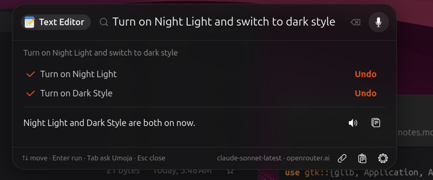

Each thing the assistant does shows up as a line with a tick when it's
done. The answer appears under your question, with a **Copy** button.

The first question after you log in can take around ten seconds while the
model loads. After that, answers start within a few seconds.

### Carrying on the conversation

Until you close the card, whatever you ask next is a follow-up, so you can
say "and Thunderbird too" or "no, the other one". When the assistant asks
you something ("Do you want me to open it?"), the box becomes a **Reply**
box, and yes-or-no questions get **Yes** and **No** buttons.

## What you can ask it to do

Here are some things to try. Use your own words. These are just examples.

| Area | Try |
| --- | --- |
| Apps | "open Firefox", "install VLC", "remove Discord", "how is Spotify installed?" |
| Windows | "put the terminal on the left", "maximize Files", "move this to the other monitor", "close the calculator" |
| Workspaces | "go to workspace 2", "move Files to workspace 3" |
| Settings | "make the text bigger", "show the battery percentage", "put the dock at the bottom", "stop the screen dimming so fast" |
| Switches | "dark mode on", "power saver", "turn off Bluetooth", "airplane mode", "do not disturb" |
| Sound and screen | "volume to 30%", "mute my mic", "play through my headphones", "brightness 40%" |
| Music and video | "pause the music", "next song", "what's playing?" |
| Networks and devices | "connect to the CoffeeShop Wi-Fi", "connect my headphones", "eject the USB stick" |
| Files and folders | "find the invoice from the plumber", "open my Downloads", "empty the trash" |
| Your day | "what's on today?", "when is my next meeting?", "am I free Friday afternoon?" |
| Notifications | "what did I miss?", "reply to Sam that I'll be late" |
| Screenshots | "screenshot this window", "screenshot Firefox in 3 seconds", "record my screen" |
| Updates | "are there any updates?", "install the updates" |
| Your computer | "which Ubuntu version is this?", "how much RAM do I have?", "why is my fan so loud?" |
| Setups and automations | "save this as Coding", "every weekday at 9, open Mail and Calendar" ([more](08-setups-and-automations.md)) |
| Your activity | "what was that page about Rust I had open yesterday?" ([more](07-everyday-ai.md#activity-recall)) |
| Questions | "what does the hot corner setting do?", "how do I share my screen in a call?" |

### Installing apps

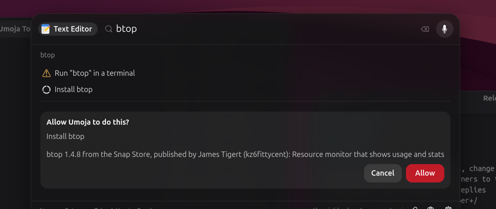

Ask for an app by name ("I need VLC"), or type a command that isn't
installed. The assistant finds the **snap** first, as App Center does, and
falls back to the Ubuntu package. It tells you exactly what it found,
including who publishes it, and asks before installing anything.

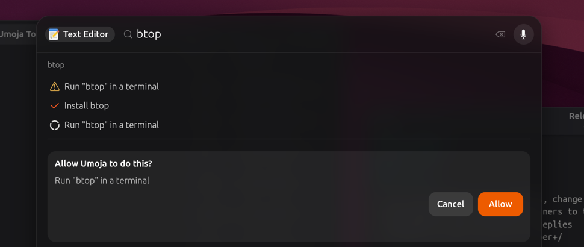

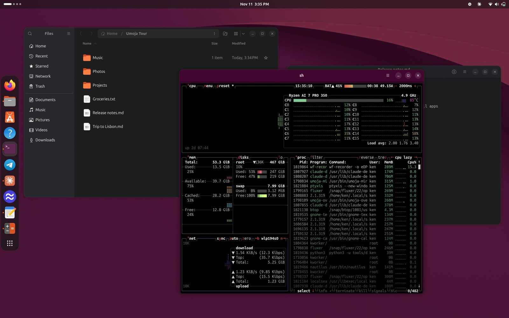

Removing apps works the same way in reverse. "Remove Discord" works out
how Discord was installed (snap, deb, Flatpak or AppImage), removes it
the right way, and shows you what will go before it does anything.

### Updates

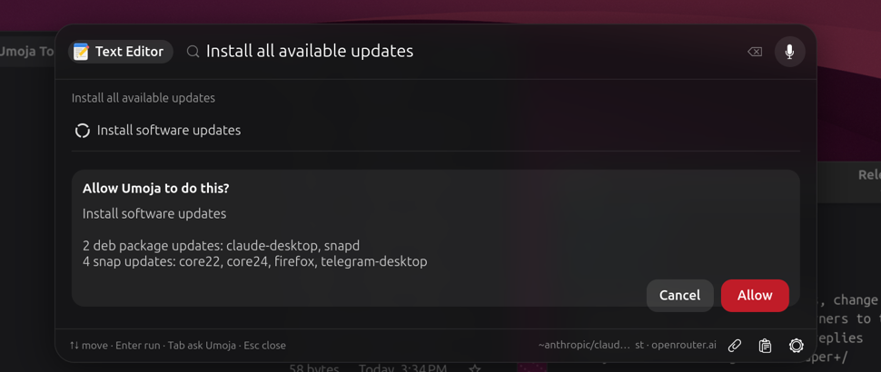

"Are there any updates?" lists what's waiting. "Install the updates" shows
the same list and asks before running them.

## What it asks first

Most things happen straight away, because they're easy to put back:
switches, settings, volume, moving windows, opening apps and files.

Some things ask **Allow Umoja to do this?** first, with a plain-words
summary of what's about to happen. **Cancel** is selected by default, so
nothing happens unless you choose **Allow**.

- Taking a screenshot or recording the screen
- Closing a window or force-quitting an app (you might lose work)
- Emptying the Trash or clearing a folder
- Logging out, suspending, restarting or powering off
- Sending a reply to a message
- Installing or removing software, and running commands (with a **red**
  Allow button)
- Saving an automation

These rules are built into Umoja's desktop tools, not left to the AI, so
they're the same whichever model you use. If you decline, the assistant
won't try again.

## Undo

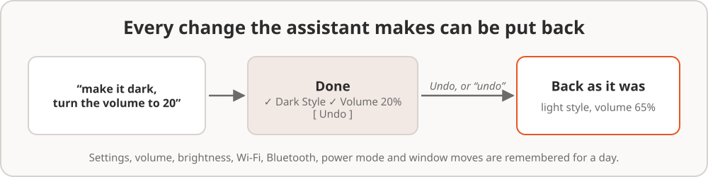

Changed your mind? After the assistant changes something, an **Undo**
button appears with the answer. Press it and everything that answer
changed goes back to how it was: the settings, the volume, the
brightness, Wi-Fi and Bluetooth, the power mode, and where windows were.

You can also say "undo", or type "undo" and choose **Undo Last Change**.
This works even after you've closed the card. Umoja remembers the last 20
changes for a day.

Some things can't be undone, like sending a message or emptying the
Trash. That's why those ask first.

## Choosing the model

The assistant runs on an AI model **on your own computer** by default.
Click the gear button at the bottom right of the card (**Assistant model and
voice**) to choose another.

**This Computer** lists the models that fit your computer's memory. The
one marked **Best for this computer** is a good balance of speed and
smarts. Models marked **Recommended** are good at using the desktop
tools. A new model downloads in the background (only on a connection that
isn't metered), and a notification shows the progress. While it downloads,
a ring in the top bar fills up; hover it to see how far along it is, how
long is left, or to cancel. Voice downloads show there too.

The model uses memory while it's loaded. It unloads by itself after ten
minutes without a question. Click **Free Memory** to unload it straight
away, for a game or a big build. It loads again with your next question.

### Using a cloud model

If you'd rather use a bigger model hosted online, the **Cloud** page works
with any service that offers an OpenAI-compatible API, such as OpenRouter
or OpenAI, or a server on your own network.

1. Enter the **Server URL**, for example `https://openrouter.ai/api/v1`.
2. Paste your **API Key**. It's kept in your login keyring, not in a file.
3. Pick a **Model**. Click the button beside the box to choose from the
   server's list. Models marked **Tools** can use the desktop tools.
4. Click **Test**, then **Use Cloud Model**.

Only the assistant's conversation goes to the cloud. Notification digests,
quick replies, crash help, captions, screenshot names and file search
always stay on your computer. See [Privacy](09-privacy-and-settings.md).

### Coding jobs

A small local model isn't the right tool for writing code. If you have a
coding agent (Claude Code, Codex, GitHub Copilot, Antigravity, OpenCode, Pi
or Gemini CLI), the assistant hands coding jobs to it. The agent opens in a
terminal with your request as its first message, already set up to use
Umoja's desktop tools. Most agents ask you before they change anything;
Pi doesn't, by design, so keep an eye on what it does.

#### Choosing your coding agent

Umoja sends coding jobs to one agent, your default. To pick it:

1. Open Ask Umoja (tap Alt, or the Copilot key).
2. Click the gear button at the bottom right of the card (**Assistant model
   and voice**).
3. At the bottom of the menu, choose an agent from **Coding agent**.

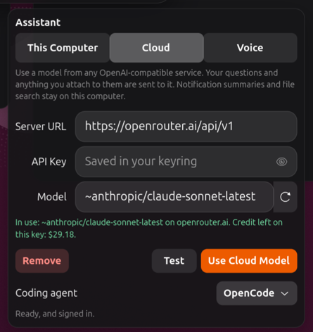

Under the list, Umoja says what that agent still needs:

- **Install**: it isn't installed yet. Umoja installs it in a terminal
  (OpenCode and Pi from their snaps, the others with their makers' own installers,
  just for you), connects it to Umoja's tools and signs you in. Installing
  a snap asks for your password.
- **Sign In**: it's installed but not signed in. This opens the agent's
  own sign-in, which uses your browser or shows a code. Umoja never sees
  your password or token. Only agents tied to their maker's account
  (Claude Code, Codex, GitHub Copilot, Antigravity) need this.
- Nothing: it's ready. OpenCode and Pi are always ready once installed,
  because they use the assistant's own model.

Until you pick one, the first agent Umoja finds installed is used. Pick
**None** to turn the hand-off off. You can also ask the assistant to
"install OpenCode".

OpenCode and Pi get the assistant's models: the one on this computer, and
your cloud model when you have one, so they work without signing in. When
you change the assistant's model, they follow.

Pi works without signing in too: it gets the assistant's local model, and
the cloud model if you have one, and starts on the one the assistant uses.
Type `/model` in Pi to switch, or `/login` to add a provider of your own.
The local model is small, so give Pi a cloud model for bigger jobs.

#### Using your coding agent

Ask for a coding job in your own words, in Ask Umoja, without naming the
agent:

- "Write me a script that renames my photos by date"
- "Write an app in Rust: a hello world GTK 4 window, in a new project
  called hello-gtk in my Projects folder. Don't compile it."

The assistant asks before it hands the job over. Click **Allow**, and your
coding agent opens in a terminal, in the folder you named (or your home
folder), and starts on the job. From there you talk to the agent itself.

When your question looks like a coding job, Ask Umoja also shows a
**Continue in** chip with your agent's name (for example **Continue in
OpenCode**). Click it to send the question straight to the agent, without
the assistant.

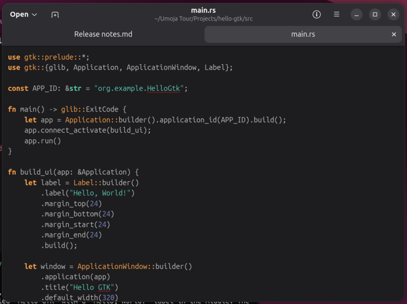

To use another agent for one job, name it: "have Codex fix the failing
test in ~/src/app". Your choice of coding agent stays as it is. To open
your agent with a keyboard shortcut, set `ai-agent-hotkey` (see
[Settings](09-privacy-and-settings.md)).

## Your background agent

Some jobs take a while and don't need you watching: plan a weekend away,
compare a few options and write them up, sort a messy folder, make sense of
a bank statement. Hand them to your **background agent**. Hermes is the
first one Umoja offers. It works on its own, in a sandbox on your computer,
while you get on with other things. It can't see your screen, your apps or
your files, only its own folder and the folders you share with it, and it
asks before it goes anywhere new on the internet.

### Setting it up

1. Open Ask Umoja and click the gear button (**Assistant model and
   voice**).
2. Under **Background agent**, pick how often it should ask you first:
   - **Careful**: before every new site and every risky command.
   - **Balanced** (the default): a few research sites, like Wikipedia, are
     open; it asks for the rest.
   - **Hands-off**: only when something looks risky.
3. Click **Set Up**. If your computer needs to allow sandboxes first, it
   asks for your password. The first setup downloads the agent once and
   takes a few minutes. Follow along from the **Agents** button on the top
   bar.

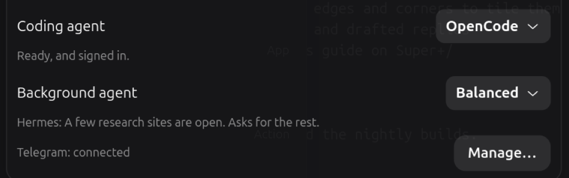

### Giving it a job

Type `@agent` (or its name, `@hermes`) and the job in Ask Umoja:

- "@agent plan a relaxed 3-day weekend in Lisbon for two, with a rough
  budget"
- "@agent read my bank export and tell me which subscriptions I could
  cancel"

As soon as you type the `@`, the top row shows which agent gets the job.
Press Enter, and it starts. Its files land in **~/Agents/Hermes**.

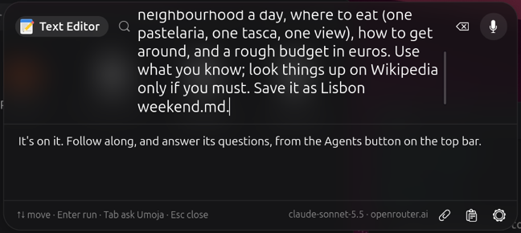

### Following along, and when it asks

The **Agents** button on the top bar shows what the agent is doing. A dot
means it's working; a number means it's waiting for you. Click it for
each job's progress, a **Stop** button, and the cards where it asks:

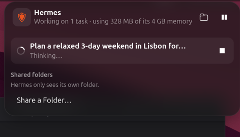

- **Allow** or **Deny** a new website (**Always Allow** for one you
  trust).
- **Allow** or **Deny** a command that could change things.
- A question, with a box for your answer.

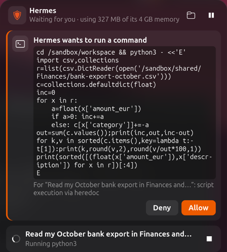

The same requests come as notifications. Quick Settings has an **Agents**
tile too: it says what the agent is doing, and turning it off pauses it.

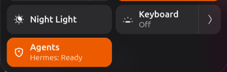

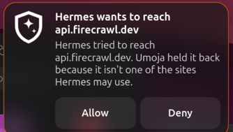

### Reading the answer, and replying

When a job is done, a notification says so. Click **Open** (or the
notification), or click the job in the Agents menu. Ask Umoja shows the
whole answer, a button that opens its file, and a reply box underneath.

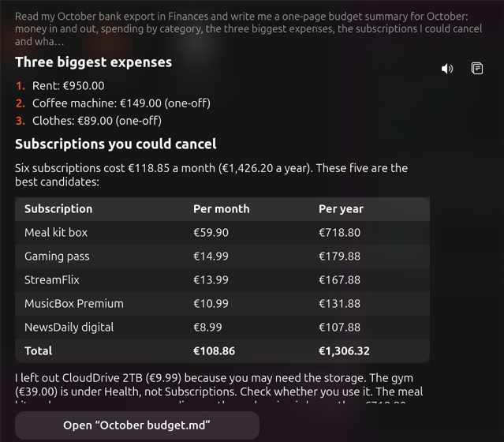

Finished jobs stay in the Agents menu so you can come back to them. To
take one off the list, click its **×**. Its files stay in your agent's
folder.

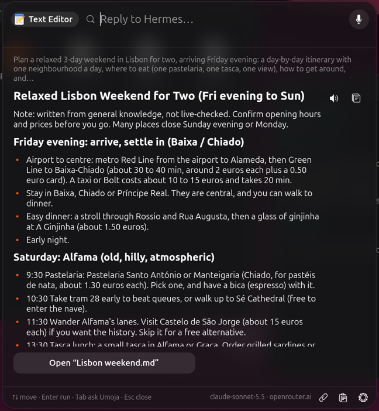

If the answer isn't quite right, or ends with a question, type your reply
there ("add a rainy-day plan for Saturday") and press Enter. The agent
carries on from the same job, with everything it already knows. Its
files open in **Apostrophe**, a Markdown viewer that shows headings,
lists, images and links properly.

### Sharing a folder

The agent only sees its own folder until you share another one. In the
Agents menu, under **Shared folders**, click **Share a Folder…** and pick
it. A folder is shared read-only, which is enough for reading a bank
statement. Tick **Can change** when the agent needs to change things there
(tidying Downloads). The **×** stops sharing it. A shared folder that you
delete or move stops being shared.

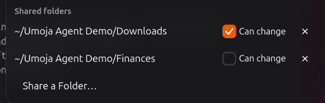

### Sending it jobs from your phone

The agent can answer you in Telegram, so you can hand it jobs when you're
away from your computer. Type "telegram" in Ask Umoja and pick **Talk to
Hermes from Telegram**, or click **Connect…** next to **Telegram** under
**Background agent** in the settings. The guided setup takes three steps:

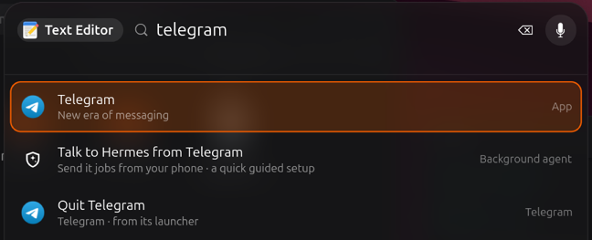

1. **Make a bot.** Click **Open BotFather in Telegram**, send `/newbot`
   and pick a name. BotFather replies with a token. Paste the whole
   message into the box; Umoja finds the token in it.
2. **Say hi.** Click **Open @yourbot** and send it any message from your
   own Telegram account. That's how the agent knows it's you.
3. **Is this you?** Check the name and click **Yes, Connect**. The bot
   says hello back.

From then on the agent only answers your account. While it works on a
message from Telegram, the Agents button and the Quick Settings tile show
it, and the job is listed in the Agents menu with its answer. To stop it,
send `/stop` in Telegram.

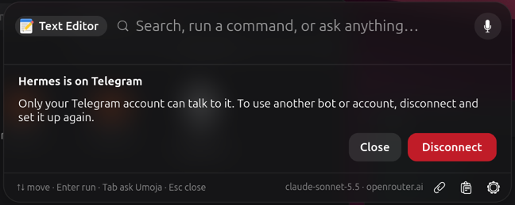

When a Telegram job needs a website the agent may not use yet, the
request comes to your computer as usual, and Telegram tells you about it.
You answer it on your computer (the notification or the Agents menu), so
nothing inside the sandbox can answer for you. The agent can't reach the site in the meantime, so if it
already answered without it, ask again once you've allowed it. Your bot's token is kept
in your keyring. To stop, open the same setup and click **Disconnect**.

### Pausing, and closing the lid

**Pause** in the Agents menu (or the Quick Settings tile) stops every job
and the sandbox until you resume. It says **Pausing…** or **Resuming…**
while that happens, which can take a minute. If your laptop sleeps while
the agent is working, it carries on when you open the lid.

The agent uses the same model as the assistant: the local model, or your
cloud model if you set one up. It needs a model that can hold a long
conversation, so on computers with little memory a cloud model works
better.
