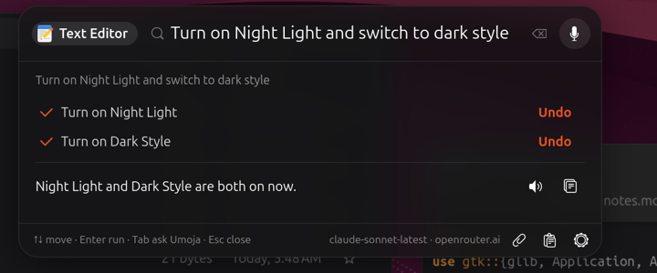
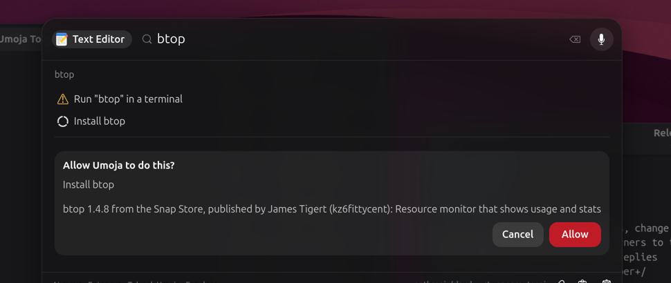
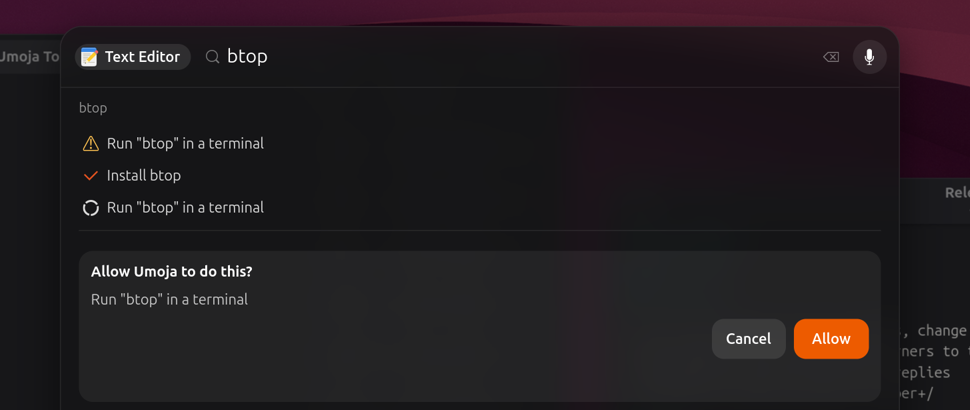
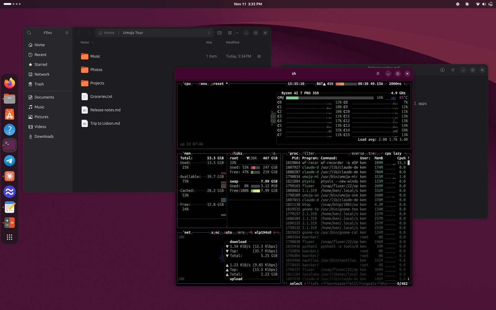
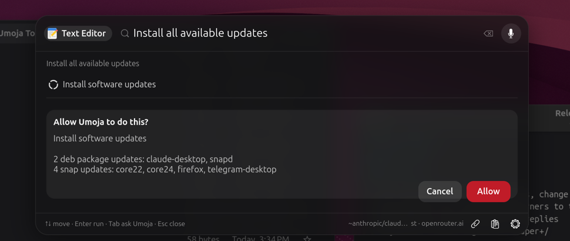
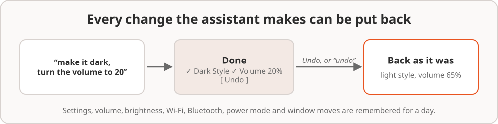
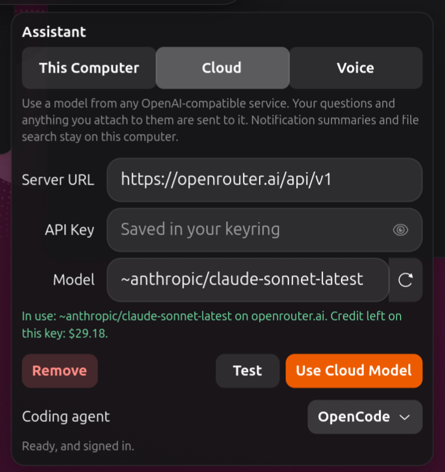
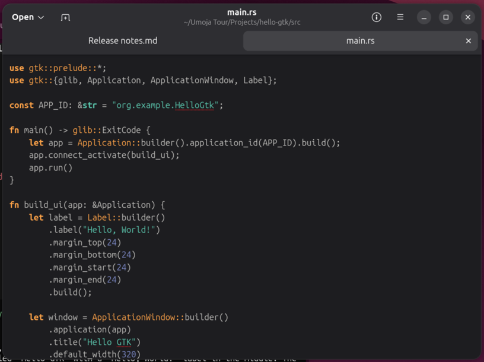

# 6. The assistant

The assistant is an AI that lives in Ask Umoja and can **do things** on the
desktop, not just talk about them. Ask in your own words. It does the work,
shows you each step, asks before anything that matters, and lets you undo
it afterwards.

## Asking

1. Open Ask Umoja (**Copilot**, or tap **Alt**).
2. Type what you want, in plain words.
3. Press **Enter** on the **Ask Umoja** row, or **Tab** from anywhere.

Each thing the assistant does shows up as a line with a tick when it's
done. The answer appears under your question, with a **Copy** button.

The first question after you log in can take around ten seconds while the
model loads. After that, answers start within a few seconds.

### Carrying on the conversation

Until you close the card, whatever you ask next is a follow-up, so you can
say "and Thunderbird too" or "no, the other one". When the assistant asks
you something ("Do you want me to open it?"), the box becomes a **Reply**
box, and yes-or-no questions get **Yes** and **No** buttons.

## What you can ask it to do

Here are some things to try. Use your own words. These are just examples.

| Area | Try |
| --- | --- |
| Apps | "open Firefox", "install VLC", "remove Discord", "how is Spotify installed?" |
| Windows | "put the terminal on the left", "maximize Files", "move this to the other monitor", "close the calculator" |
| Workspaces | "go to workspace 2", "move Files to workspace 3" |
| Settings | "make the text bigger", "show the battery percentage", "put the dock at the bottom", "stop the screen dimming so fast" |
| Switches | "dark mode on", "power saver", "turn off Bluetooth", "airplane mode", "do not disturb" |
| Sound and screen | "volume to 30%", "mute my mic", "play through my headphones", "brightness 40%" |
| Music and video | "pause the music", "next song", "what's playing?" |
| Networks and devices | "connect to the CoffeeShop Wi-Fi", "connect my headphones", "eject the USB stick" |
| Files and folders | "find the invoice from the plumber", "open my Downloads", "empty the trash" |
| Your day | "what's on today?", "when is my next meeting?", "am I free Friday afternoon?" |
| Notifications | "what did I miss?", "reply to Sam that I'll be late" |
| Screenshots | "screenshot this window", "screenshot Firefox in 3 seconds", "record my screen" |
| Updates | "are there any updates?", "install the updates" |
| Your computer | "which Ubuntu version is this?", "how much RAM do I have?", "why is my fan so loud?" |
| Setups and automations | "save this as Coding", "every weekday at 9, open Mail and Calendar" ([more](08-setups-and-automations.md)) |
| Your activity | "what was that page about Rust I had open yesterday?" ([more](07-everyday-ai.md#activity-recall)) |
| Questions | "what does the hot corner setting do?", "how do I share my screen in a call?" |

### Installing apps

Ask for an app by name ("I need VLC"), or type a command that isn't
installed. The assistant finds the **snap** first, as App Center does, and
falls back to the Ubuntu package. It tells you exactly what it found,
including who publishes it, and asks before installing anything.

Removing apps works the same way in reverse. "Remove Discord" works out
how Discord was installed (snap, deb, Flatpak or AppImage), removes it
the right way, and shows you what will go before it does anything.

### Updates

"Are there any updates?" lists what's waiting. "Install the updates" shows
the same list and asks before running them.

## What it asks first

Most things happen straight away, because they're easy to put back:
switches, settings, volume, moving windows, opening apps and files.

Some things ask **Allow Umoja to do this?** first, with a plain-words
summary of what's about to happen. **Cancel** is selected by default, so
nothing happens unless you choose **Allow**.

- Taking a screenshot or recording the screen
- Closing a window or force-quitting an app (you might lose work)
- Emptying the Trash or clearing a folder
- Logging out, suspending, restarting or powering off
- Sending a reply to a message
- Installing or removing software, and running commands (with a **red**
  Allow button)
- Saving an automation

These rules are built into Umoja's desktop tools, not left to the AI, so
they're the same whichever model you use. If you decline, the assistant
won't try again.

## Undo

Changed your mind? After the assistant changes something, an **Undo**
button appears with the answer. Press it and everything that answer
changed goes back to how it was: the settings, the volume, the
brightness, Wi-Fi and Bluetooth, the power mode, and where windows were.

You can also say "undo", or type "undo" and choose **Undo Last Change**.
This works even after you've closed the card. Umoja remembers the last 20
changes for a day.

Some things can't be undone, like sending a message or emptying the
Trash. That's why those ask first.

## Choosing the model

The assistant runs on an AI model **on your own computer** by default.
Click the round model button at the bottom of the card to choose another.

**This Computer** lists the models that fit your computer's memory. The
one marked **Best for this computer** is a good balance of speed and
smarts. Models marked **Recommended** are good at using the desktop
tools. A new model downloads in the background (only on a connection that
isn't metered), and a notification shows the progress.

The model uses memory while it's loaded. It unloads by itself after ten
minutes without a question. Click **Free Memory** to unload it straight
away, for a game or a big build. It loads again with your next question.

### Using a cloud model

If you'd rather use a bigger model hosted online, the **Cloud** page works
with any service that offers an OpenAI-compatible API, such as OpenRouter
or OpenAI, or a server on your own network.

1. Enter the **Server URL**, for example `https://openrouter.ai/api/v1`.
2. Paste your **API Key**. It's kept in your login keyring, not in a file.
3. Pick a **Model**. Click the button beside the box to choose from the
   server's list. Models marked **Tools** can use the desktop tools.
4. Click **Test**, then **Use Cloud Model**.

Only the assistant's conversation goes to the cloud. Notification digests,
quick replies, crash help, captions, screenshot names and file search
always stay on your computer. See [Privacy](09-privacy-and-settings.md).

### Coding jobs

A small local model isn't the right tool for writing code. If you have a
coding agent (Claude Code, Codex, GitHub Copilot, Antigravity, OpenCode or
Gemini CLI), the assistant hands coding jobs to it. The agent opens in a
terminal with your request as its first message, already set up to use
Umoja's desktop tools, and it asks you before it changes anything.

#### Choosing your coding agent

Umoja sends coding jobs to one agent, your default. To pick it:

1. Open Ask Umoja (tap Alt, or the Copilot key).
2. Click the round model button at the bottom of the card.
3. At the bottom of the menu, choose an agent from **Coding agent**.

Under the list, Umoja says what that agent still needs:

- **Install**: it isn't installed yet. Umoja installs it in a terminal
  (OpenCode from its snap, the others with their makers' own installers,
  just for you), connects it to Umoja's tools and signs you in. Installing
  a snap asks for your password.
- **Sign In**: it's installed but not signed in. This opens the agent's
  own sign-in, which uses your browser or shows a code. Umoja never sees
  your password or token.
- Nothing: it's ready.

Until you pick one, the first agent Umoja finds installed is used. Pick
**None** to turn the hand-off off. You can also ask the assistant to
"install OpenCode".

If the assistant uses a cloud model when OpenCode is set up, OpenCode gets
the same model and your key, so it works without signing in.

#### Using your coding agent

Ask for a coding job in your own words, in Ask Umoja, without naming the
agent:

- "Write me a script that renames my photos by date"
- "Write an app in Rust: a hello world GTK 4 window, in a new project
  called hello-gtk in my Projects folder. Don't compile it."

The assistant asks before it hands the job over. Click **Allow**, and your
coding agent opens in a terminal, in the folder you named (or your home
folder), and starts on the job. From there you talk to the agent itself.

When your question looks like a coding job, Ask Umoja also shows a
**Continue in** chip with your agent's name (for example **Continue in
OpenCode**). Click it to send the question straight to the agent, without
the assistant.

To use another agent for one job, name it: "have Codex fix the failing
test in ~/src/app". Your choice of coding agent stays as it is. To open
your agent with a keyboard shortcut, set `ai-agent-hotkey` (see
[Settings](09-privacy-and-settings.md)).
