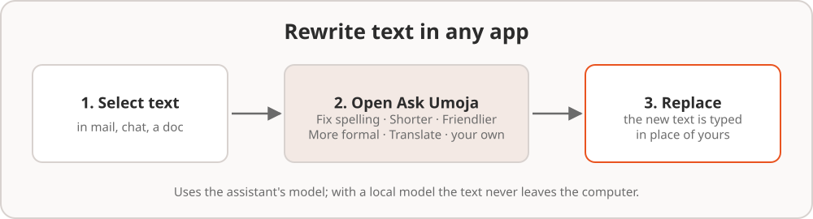
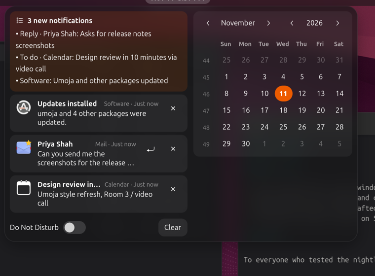
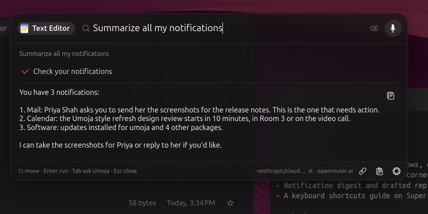
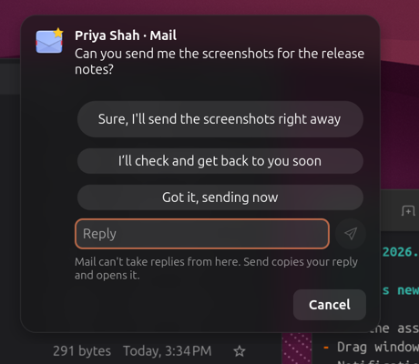
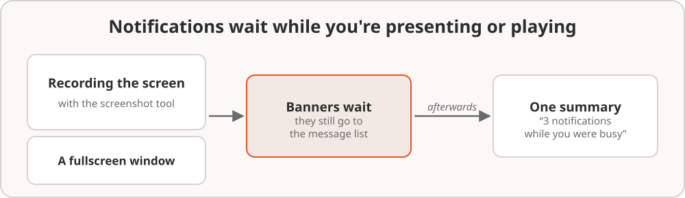
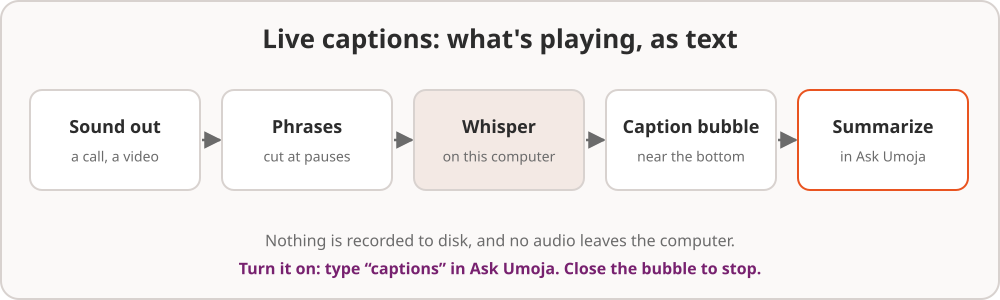
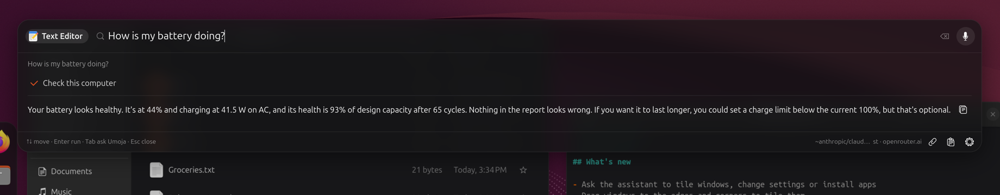

# 7. AI in your everyday work

The assistant isn't only in Ask Umoja. Small, useful bits of AI are spread
around the desktop, in the places you already work. Almost all of them run
on your own computer.

## Rewrite text in any app

Writing an email, a chat message or a document and want it shorter, kinder
or simply spelled right? You don't need to copy it anywhere.

1. **Select the text** in any app.
2. Press **Super+Shift+A**. Ask Umoja opens with your selection attached.
   You can also open Ask Umoja and choose **Selected Text** from the
   paperclip button.
3. Pick one of:
   - **Fix Spelling and Grammar**
   - **Make It Shorter**
   - **Make It Friendlier**
   - **Make It More Formal**
   - **Translate** (into your language, or into English if it's already
     in yours)

   Or type your own instruction, such as "make it sound less annoyed" or
   "turn it into bullet points", and choose **Rewrite it**.
4. Read the new version. If you like it, click **Replace the Selection**.
   Umoja types it in place of your text, in the app you were in.

If the app won't accept typed text, the new version is copied instead, so
you can paste it.

## Ask about what's on screen

The assistant only looks at your screen when you ask it to.

- **Super+Shift+A** attaches the text you selected or, with nothing
  selected, the window you're in. Ask a question, or just press **Enter**
  to have it explained.
- The paperclip button attaches **Selected Text**, the **Current
  Window**, a **Screen Area…** you drag out, or the **Last Copied Text**.
  Attach several and ask about them together: "compare these two".

Windows and areas are read as text with OCR. Pictures aren't kept.

## The clipboard history

**Super+Shift+V**, or the clipboard button at the bottom of Ask Umoja,
lists what you copied this session, newest first. Search it, copy an old
entry again, or attach it to a question. Each entry can also be:

- **Translated** into your language
- **Reformatted** (tidy spacing, lists and line breaks)
- **Summarized**

The history lives in memory only and is gone when you log out. It skips
passwords copied from a password manager, and other apps can't read it.

## Notifications: what you missed, and quick replies

**A summary of what you missed.** Open the notification list (click the
clock, or **Super+V**). When notifications piled up while you were away, a
card at the top sums them up in a few lines. It merges messages from the
same person or app, and says which ones need a reply or an action.

You can also ask "what did I miss?":

**Quick replies.** Chat and mail notifications get a **Reply** button. It
offers three short replies drafted from the message, in the message's own
language. Pick one, edit it, or write your own, then **Send**.

Apps that accept replies from notifications get yours directly. For other
apps, the reply is copied and the app is brought forward so you can paste
it.

## Automatic Do Not Disturb

Nobody wants a private message popping up in the middle of a
presentation. Umoja holds notification pop-ups back while:

- you're **recording your screen**, or
- a **full-screen** window has the focus, such as a game, a video or
  slides.

Nothing is lost. Everything still goes to the notification list, and
urgent notifications (like a low battery) still show. When you're done, a
single notification says how many came in. Click **Show** to see them.

To turn it off, ask "turn off automatic do not disturb", or run
`gsettings set org.umoja.shell auto-do-not-disturb false`.

## Your calendar

Add your calendars in **Settings › Online Accounts** (Google, Microsoft
365, Nextcloud and others) or in GNOME Calendar. Their events then show up:

- **in the date menu**: click the clock to see today's events under the
  calendar. Days with events are marked, and clicking a day shows that
  day's events.
- **in the assistant**: "what's on today?", "when is my next meeting?",
  "am I free on Friday afternoon?", "what do I have next week?".

## Finding files

Umoja keeps an index of your home folder, so you can find files by what
they're **about**, not only by their names.

- In **Ask Umoja** or the **app grid**, just type: "lease pdf", "beach
  photos june", "budget 2026".
- Or ask: "find my tax spreadsheet from 2025", "where's the invoice from
  the plumber?", "open the photos from the wedding".

The index reads the start of text files, PDFs, office documents and notes,
and knows photos and videos by name, folder, type and date. Each code
project counts as one entry, described by its README. Hidden folders,
anything a `.gitignore` leaves out, and folders with a `.nomedia` file are
skipped. The index is built at idle priority, and it only reads file
contents while you're plugged in.

## Live captions

Live captions show what's being said in a call, a video or a podcast, as
text near the bottom of the screen. They help in a noisy café, with a
strong accent, when you can't turn the sound up, and if you're hard of
hearing.

- **Turn them on**: type "captions" into Ask Umoja and choose **Live
  Captions**.
- **Turn them off**: click × on the caption bubble, or choose **Live
  Captions** again.
- **Summarize**: the button on the bubble opens Ask Umoja with what was
  said so far, and asks for a summary with any decisions and to-dos.
  Perfect after a meeting.

The first time, Umoja downloads a speech model (about 150 MB), and the
bubble says so. The speech-to-text runs on your computer with Whisper. No
audio is saved or sent anywhere. Captions follow whatever comes out of
your speakers or headphones, so they work with any app.

## Activity recall

"What was that page I had open yesterday afternoon?" "Which spreadsheet
was I working on before lunch?" Activity recall lets the assistant answer
questions like these.

It's **off** until you turn it on. Ask "turn on activity recall", or run
`gsettings set org.umoja.shell activity-recall true`. From then on,
Umoja keeps a **text-only** timeline on your computer of:

- which window was in front: the app and its title, once you've stayed on
  it for a few seconds
- files you opened
- notifications you received

There are **no screenshots** and **no keystrokes**. The timeline is stored
in your home folder (`~/.local/share/umoja/recall`), readable only by you,
and days older than two weeks are deleted. Change how long it's kept with
"keep my activity for 7 days".

Then just ask: "what was I reading about Rust yesterday?", "which files
did I open this morning?", "what did Dana message me about on Monday?".
Say "forget today's activity", or "forget all my activity", to delete it.
The assistant asks first.

## Troubleshooting your computer

Describe a problem and the assistant checks the computer before it
answers: "why is my fan so loud?", "why won't Wi-Fi connect?", "no sound
from my speakers", "my disk is full", "battery draining fast".

It gathers a short report on CPU and memory, temperatures, battery, the
network, Bluetooth, sound, disk space, failed services and recent errors.
Then it tells you the most likely cause and shows the evidence. These
checks only look. Nothing is changed. If a fix needs a command, it asks
first.

## When an app crashes

If an app crashes, a notification says so, with an **Ask Why** button. The
assistant reads the crash report and explains it in plain words: was the
computer out of memory, did it start after an update, does it keep
happening? This always runs on your computer. **Don't Show for This App**
stops these notifications for that app.

## Dictation

If you install **Myna** (set it up with Myna Settings), press **Super+J**
to talk instead of type, in any app. The microphone button on Ask Umoja's
card dictates a question.
