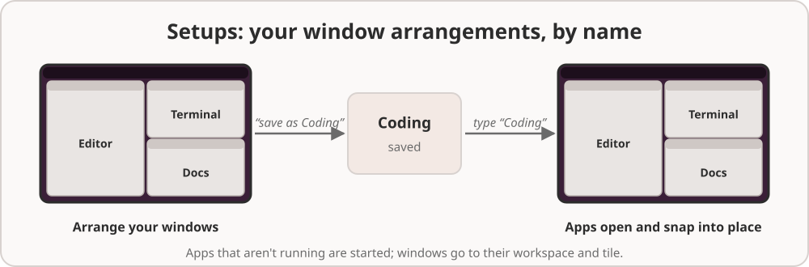
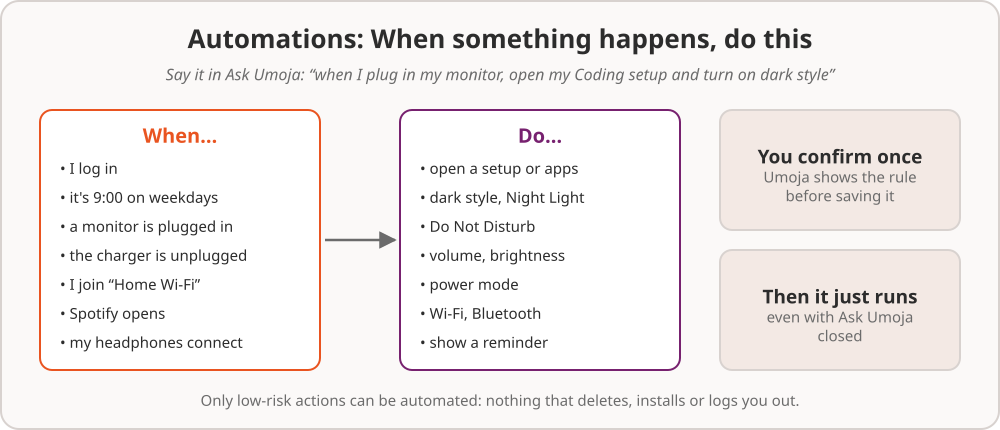

# 8. Setups and automations

Two features to save you from doing the same thing every day.

## Setups

A **setup** is a named arrangement of apps and windows. "Coding" might be
your editor on the left half, a terminal top right and the docs bottom
right. "Writing" might be the text editor and Firefox side by side. Once
you've saved one, a single word brings it all back.

### Saving a setup

The easy way: arrange your windows the way you like them, open Ask Umoja,
and say **"save this as Coding"**. Umoja remembers each app, which
workspace it's on and where it sits (left half, a quarter, maximized and
so on).

You can also describe a setup without arranging anything: "make a Writing
setup with the text editor on the left and Firefox on the right", or "a
Meeting setup with Zoom maximized on workspace 2 and Notes on workspace 1".

### Bringing it back

Type the setup's name into Ask Umoja ("coding") and choose **Set Up
"Coding"**. Or say "set up for coding". Umoja:

1. starts any of the apps that aren't running,
2. waits for their windows to appear,
3. moves each window to its workspace and tiles it into its place,
4. and takes you to the setup's first workspace.

Windows you already had open are used rather than opening new ones.

### Managing setups

- "what setups do I have?" lists them.
- Saving again with the same name replaces the setup.
- "delete the Coding setup" removes it (it asks first).

Setups are stored in `~/.config/umoja/setups.json`.

## Automations

An **automation** is a rule: *when* something happens, *do* these things.
You make one by saying it, in plain words.

### Making one

Open Ask Umoja and say what you want:

- "When I plug in my monitor, open my Coding setup."
- "Every weekday at 9, open Mail and Calendar."
- "When I unplug the charger, switch to power saver and lower the
  brightness to 40%."
- "When I join the Office Wi-Fi, turn on Do Not Disturb."
- "When my headphones connect, set the volume to 30%."
- "At 10 pm, turn on dark style and Night Light."
- "When Spotify opens, turn off notifications." (Do Not Disturb)
- "Every Friday at 4, remind me to send the timesheet."

The assistant turns your words into a rule and shows it to you in plain
words, such as *When a monitor is plugged in: open the setup “Coding”*.
It's only saved when you choose **Allow**.

From then on it just runs, even if you never open Ask Umoja again. It runs
after you log in, in the background, and only while you're logged in.

### What can start an automation

| When | Say something like |
| --- | --- |
| You log in | "when I log in" |
| A time of day, on some days | "every day at 8:30", "on weekdays at 9", "Saturdays at 10" |
| A monitor is plugged in or unplugged | "when I connect a monitor", "when I unplug the monitor" |
| The charger is plugged in or unplugged | "when I plug in", "when I'm on battery" |
| You join or leave a network | "when I connect to Home Wi-Fi", "when I go offline" |
| An app opens | "when Zoom opens" |
| A Bluetooth device connects | "when my headphones connect" |

### What an automation can do

Only things that are safe to do without asking: open apps, a setup, a web
page or a folder; Dark Style, Night Light, Do Not Disturb, Wi-Fi and
Bluetooth; volume, sound output and brightness; the power mode; the
wallpaper and other settings; media playback; switching workspace and
arranging windows; connecting a Bluetooth device; and showing you a
reminder notification.

Automations **can't** delete things, install software, send messages, log
out or power off. Those always need you there to say yes.

### Managing automations

- "what automations do I have?" lists them, numbered.
- "pause the monitor automation" or "turn automation 2 back on".
- "delete the 9 o'clock automation".

Automations are stored in `~/.config/umoja/automations.json`. If two
events come in quick succession (a monitor that flickers on and off, say),
a rule won't run twice within 30 seconds.
