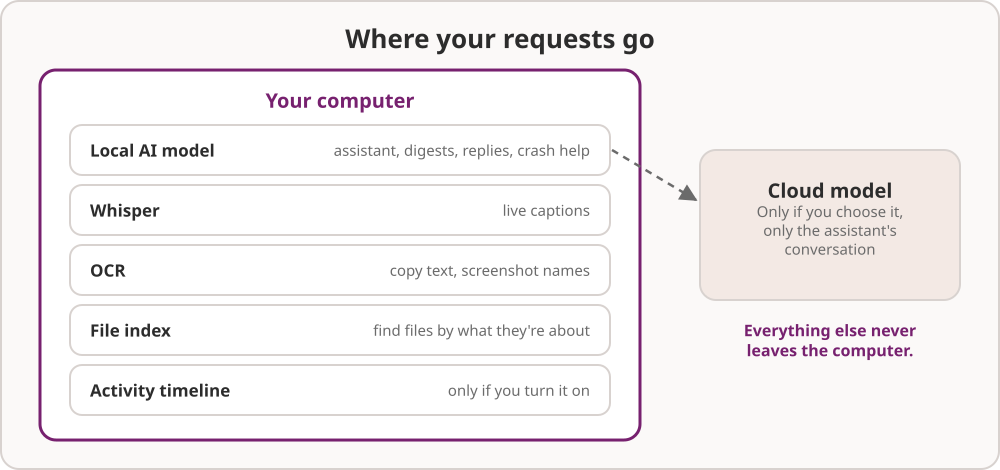

# 9. Privacy and settings

## What stays on your computer



Umoja's AI runs **on your own computer by default**, on its own copy of
Lemonade, which only listens to apps on this computer. Out of the box,
nothing you type, copy, say or show goes anywhere else.

- **The assistant** uses the local model unless you choose a cloud model.
  If you do, what you ask it goes to that provider: your question, any text
  you attached, and what its tools find, such as window titles or file
  names when you ask about them. The provider's privacy policy applies.
- **Always on your computer**, even with a cloud model: notification
  summaries and quick replies, crash help, live captions, screenshot names,
  file search and the activity timeline.
- **Your screen** is only read when you ask: **Super+Shift+A**, the
  paperclip button, or a question about "this window". Pictures are turned
  into text and not kept.
- **Live captions** never save or send audio.
- **The clipboard history** lives in memory only and skips passwords.
- **Activity recall** is off until you turn it on, keeps text only, and is
  readable only by you.
- **Ask Umoja** remembers which rows you choose, never what you typed, and
  nothing at all while **Settings › Privacy › Remember App Usage** is off.
- **Your cloud API key** is kept in your login keyring. **Remove** on the
  Cloud page deletes it.
- **Models** only download on connections that aren't metered.

### Where things are kept

| What | Where |
| --- | --- |
| AI models | `~/.cache/umoja/lemonade` |
| File search index | `~/.cache/umoja/files` |
| Setups | `~/.config/umoja/setups.json` |
| Automations | `~/.config/umoja/automations.json` |
| Activity timeline (if on) | `~/.local/share/umoja/recall` |
| Ask Umoja's row history | `~/.local/share/umoja/ask-history.json` |
| Undo history (for a day) | in memory for this login only (`$XDG_RUNTIME_DIR/umoja`) |
| Screenshots | `~/Pictures/Screenshots` |
| Screen recordings | `~/Videos/Screencasts` |

## Changing settings

You rarely need to touch the settings below: Settings and the assistant
cover everything day to day. Just ask: "turn off screenshot names", "keep
my activity for a week", "unload the model after 30 minutes".

If you prefer the terminal, every Umoja setting is in the
`org.umoja.shell` schema:

```sh
gsettings set org.umoja.shell screenshot-names false
gsettings reset org.umoja.shell screenshot-names
```

| Setting | Default | What it does |
| --- | --- | --- |
| `auto-do-not-disturb` | `true` | Hold notification pop-ups while recording the screen or in full screen |
| `screenshot-names` | `true` | Add a few words about what a screenshot shows to its file name |
| `activity-recall` | `false` | Keep the text-only activity timeline |
| `activity-recall-days` | `14` | Days the activity timeline is kept |
| `captions-model` | `'Whisper-Base'` | The speech model for live captions |
| `clipboard-history` | `true` | Keep a clipboard history this session |
| `file-search-enabled` | `true` | Index your home folder for file search |
| `crash-notifications` | `true` | Tell you when an app crashes, with **Ask Why** |
| `crash-notifications-muted` | `[]` | Apps whose crashes don't notify you |
| `assistant-idle-unload` | `10` | Minutes before an idle local model is unloaded (0 keeps it loaded) |
| `lemonade-model` | `'Qwen3-4B-Instruct-2507-GGUF'` | The local model (set by the model picker) |
| `cloud-base-url`, `cloud-model` | `''` | The cloud model (set on the Cloud page) |
| `ai-agent` | `''` | The coding agent for coding jobs: `claude`, `codex`, `copilot`, `agy` (Antigravity), `opencode`, `gemini` or `none` |
| `ask-umoja-alt-tap` | `true` | A tap of Alt opens Ask Umoja, until a Copilot key is seen |
| `screensaver-enabled` | `true` | Show the screensaver before the screen blanks |
| `screensaver-duration` | `300` | Seconds the screensaver runs before the screen turns off |
| `ask-about-screen-hotkey` | **Super+Shift+A** | Ask about the selection or the current window |
| `clipboard-history-hotkey` | **Super+Shift+V** | Show the clipboard history |
| `copy-text-hotkey` | **Super+Ctrl+Print** | Copy the text in a screen area |
| `shortcuts-guide-hotkey` | **Super+/** | Show the keyboard shortcuts guide |
| `tile-top-left` and the other `tile-*` keys | **Super+keypad 7**, **9**, **1**, **3** | Tile to a quarter |
| `dictation-hotkey`, `ai-agent-hotkey` | none | Extra shortcuts for dictation and the coding agent |

Everything else (the wallpaper, the dock, keyboard shortcuts, displays,
power) uses Ubuntu's own settings, so the Settings app is the place to
change it.
