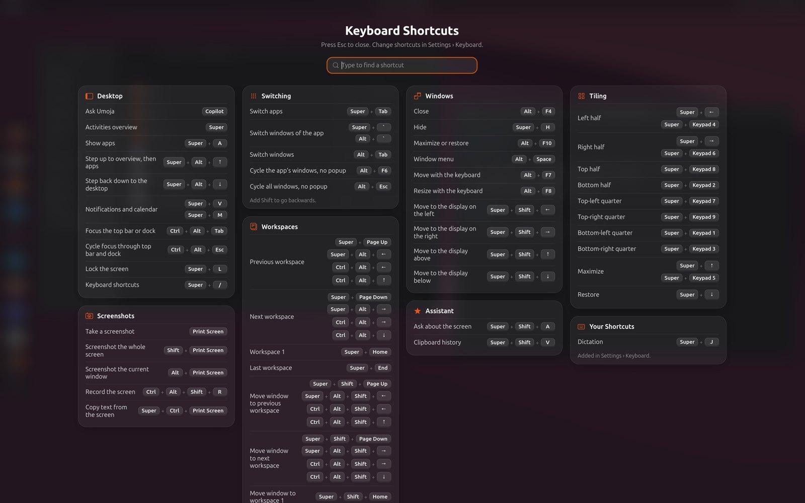

# 10. Keyboard shortcuts

Press **Super+/** at any time for the shortcuts guide. It lists every
shortcut, including ones you've added yourself, and you can search it.
Change shortcuts in **Settings › Keyboard › Keyboard Shortcuts**.

## Desktop

| Keys | What it does |
| --- | --- |
| **Copilot**, or tap **Alt** | Ask Umoja |
| **Super** | Activities overview |
| **Super+A** | Show all apps |
| **Super+Alt+Up** / **Super+Alt+Down** | Step up to the overview and then the apps, or back down to the desktop |
| **Super+V** (or **Super+M**) | Notifications and calendar |
| **Ctrl+Alt+Tab** | Move the keyboard focus to the top bar or the dock |
| **Super+L** | Lock the screen |
| **Super+/** | Keyboard shortcuts guide |

## The assistant

| Keys | What it does |
| --- | --- |
| **Super+Shift+A** | Ask about (or rewrite) the selected text, or the current window |
| **Super+Shift+V** | Clipboard history |
| **Super+J** | Dictation, with Myna |

## Inside Ask Umoja

| Keys | What it does |
| --- | --- |
| **↑** / **↓** | Move through the rows |
| **Enter** | Run the selected row |
| **Tab** | Ask the assistant |
| **Backspace** in an empty box | Search everything, not just the current app |
| **Escape** | Close |

## Switching

| Keys | What it does |
| --- | --- |
| **Super+Tab** | Switch apps (add **Shift** to go back) |
| **Alt+Tab** | Switch windows (add **Shift** to go back) |
| **Alt+`** or **Super+`** | Switch windows of the same app |
| **Alt+F6** | Cycle the app's windows, without the switcher |
| **Alt+Esc** | Cycle all windows, without the switcher |

## Windows

| Keys | What it does |
| --- | --- |
| **Alt+F4** | Close |
| **Super+H** | Hide (minimize) |
| **Alt+F10** | Maximize or restore |
| **Alt+Space** | Window menu |
| **Alt+F7** / **Alt+F8** | Move or resize with the keyboard |
| **Super+Shift+Left**, **Right**, **Up**, **Down** | Move to the monitor on that side |
| **Super+drag** | Move the window from anywhere inside it |
| **Super+middle-drag** | Resize the window |
| **Super+right-click** | Window menu |

## Tiling

| Keys | What it does |
| --- | --- |
| **Super+Left** / **Super+Right** | Left or right half |
| **Super+keypad 8** / **Super+keypad 2** | Top or bottom half |
| **Super+keypad 7**, **9**, **1**, **3** | Top-left, top-right, bottom-left, bottom-right quarter |
| **Super+Up** | Maximize |
| **Super+Down** | Restore |

## Workspaces

| Keys | What it does |
| --- | --- |
| **Super+Page Up**, **Super+Alt+Left**, **Ctrl+Alt+Left** or **Ctrl+Alt+Up** | Previous workspace |
| **Super+Page Down**, **Super+Alt+Right**, **Ctrl+Alt+Right** or **Ctrl+Alt+Down** | Next workspace |
| **Super+Home** | First workspace |
| **Super+End** | Last workspace |
| **Super+Shift+Page Up** (or add **Shift** to the keys above) | Take the window to the previous workspace |
| **Super+Shift+Page Down** (or add **Shift** to the keys above) | Take the window to the next workspace |

## Screenshots

| Keys | What it does |
| --- | --- |
| **Print** | Screenshot tool |
| **Shift+Print** | Screenshot the whole screen |
| **Alt+Print** | Screenshot the current window |
| **Super+Ctrl+Print** | Copy the text in a screen area |
| **Ctrl+Alt+Shift+R** | Start or stop recording the screen |

## Media keys

Volume, mute, microphone mute, brightness, keyboard backlight, play and
pause, next and previous track all work, with a small display at the
bottom of the screen showing the new level.
