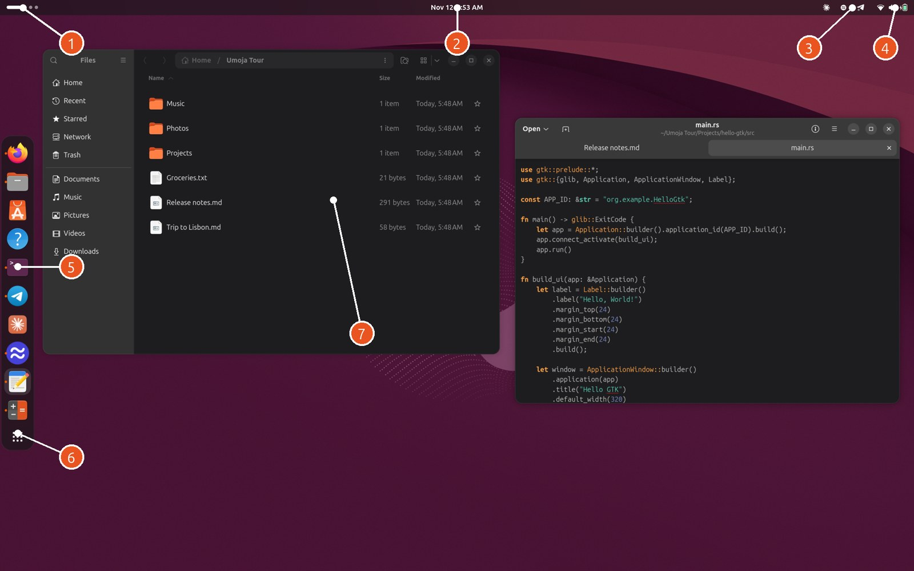

# The Umoja User Guide

Welcome to **Umoja**, a desktop for Ubuntu with an assistant built in.

If you have used Ubuntu before, most of Umoja will feel familiar right
away. It has the same top bar, dock, Settings app, keyboard shortcuts and
apps. What's new is **Ask Umoja**: one key brings up a card over whatever
you're doing. From there you can launch apps, flip switches, do sums, find
files, rewrite text, turn on captions, or just ask for what you want in
plain words. The assistant does it for you, asks before anything that
matters, and lets you undo it afterwards.

This guide starts with the basics: getting around, opening apps and
handling windows. Then it covers everything else, one chapter at a time.
You don't need to read it in order. Skim the first two chapters, then jump
to whatever catches your eye.

## Contents

1. [Getting started](01-getting-started.md): logging in, the four keys to
   remember, and a map of the screen
2. [The basics](02-the-basics.md): the top bar, the dock, opening apps,
   handling windows, notifications, the calendar, Quick Settings, and
   locking and shutting down
3. [Windows, workspaces and displays](03-windows-and-workspaces.md):
   tiling, the layout picker, workspaces, several monitors, scaling and
   games
4. [Screenshots and screen recording](04-screenshots-and-recording.md):
   the screenshot tool, copying text from the screen, screenshot names
   that say what the picture shows, and sharing your screen or a window in
   video calls
5. [Ask Umoja](05-ask-umoja.md): the card that does everything, from
   switches and sums to emoji and setups
6. [The assistant](06-the-assistant.md): asking in plain words, what it can
   do, what it asks first, **Undo**, and choosing a model
7. [AI in your everyday work](07-everyday-ai.md): rewriting text in any
   app, asking about the screen, the clipboard history, notification
   digests and replies, automatic Do Not Disturb, your calendar, finding
   files, live captions, activity recall, crash help and troubleshooting
8. [Setups and automations](08-setups-and-automations.md): bring back a
   whole window arrangement by name, and teach the desktop "when this
   happens, do that"
9. [Privacy and settings](09-privacy-and-settings.md): what stays on your
   computer, and every Umoja setting
10. [Keyboard shortcuts](10-keyboard-shortcuts.md): the full list on one page
11. [When something goes wrong, and going further](11-troubleshooting.md):
    fixes for common problems, using Umoja's tools from other AI apps, and
    where to get help

## Reading this guide

- **Keys** are written like **Super+Shift+A**: hold the first keys and
  press the last one. **Super** is the key with the Windows or Ubuntu logo.
  The **Copilot** key is the one with the Copilot logo on newer laptops.
- **Menus and buttons** are in bold, and a path through Settings looks like
  **Settings › Displays**.
- Things you can **type into Ask Umoja** are in quotes, like "dark" or
  "what's on today?". You don't have to type them exactly as shown. The
  assistant understands your own words.

Umoja is a personal project. It is not an official Ubuntu or Canonical
product, and it changes quickly. The guide is written for the version it
ships with. You can open it at any time by typing "guide" into Ask Umoja.
